# **ASIGNATURA DE DESARROLLO BASADO EN PLATAFORMAS**
En el presente proyecto tenemos como finalidad implementar una aplicación web de acuerdo con el contenido revisado en la asignatura de desarrollo basado en plataformas
___

## DESARROLLO SEMANAS 1 Y 2

## Instrucciones T1S1

Desarrolle un proyecto que construya la primera versión de la interfaz web para una plataforma de gestión y monitoreo de incidentes de ciberseguridad.

El proyecto debe incluir:

1) estructura semántica HTML5 con header, nav, main, section, aside y footer;

2) formulario accesible para registrar incidentes con labels, ayudas contextuales y validación nativa;

3) listado simulado de incidentes y vista de detalle;

4) hoja CSS externa con box model, Flexbox, Grid y media queries;

5) evidencias de funcionamiento en escritorio y móvil;

6) justificación técnica de 600 a 800 palabras que explique cómo se aplicaron todos los temas y subtemas de la Unidad 1.

### Prompt Inicial
*"crea una página web agregando la estructura de la imagen, toma en cuenta que el propósito de la página es el siguiente: El proyecto debe incluir: **1)** estructura semántica HTML5 con header, nav, main, section, aside y footer; **2)** formulario accesible para registrar incidentes con labels, ayudas contextuales y validación nativa; **3)** listado simulado de incidentes y vista de detalle; **4)** hoja CSS externa con box model, Flexbox, Grid y media queries; **5)** evidencias de funcionamiento en escritorio y móvil; **6)** justificación técnica de 600 a 800 palabras que explique cómo se aplicaron todos los temas y subtemas de la Unidad 1. Por lo pronto solo crea algo, yo voy a corregirlo e irte guiando para que quede mejor, pero por ahora quiero tener un esqueleto"*

**Nota. -** El procedimiento adecuado sería utilizar herramientas de diseño de páginas web para determinar una interfaz preliminar. En honor al tiempo y practicar el uso de la inteligencia artificial para este propósito, vamos a tomar el diseño generado por el prompt y lo mejoraremos de manera progresiva. 

### Observaciones preliminares
Una vez utilizado un prompt personalizado obtendremos una página web preliminar. El procedimiento académico en este punto consiste en el aprendizaje con la práctica; en este sentido lo más coherente es explorar el código, entenderlo de manera íntegra, determinar un conjunto de observaciones preliminares, ya sean estas preferencias de diseño o funcionales, comprender cuáles son las porciones de código que tienen un efecto directo con estas observaciones y, finalmente, tratar todas las observaciones documentadas para el primer commit. Este proceso naturalmente se debe realizar en congruencia con las instrucciones para las tareas 1 y 2, adicionalmente el enfoque de crear el "esqueleto" del proyecto utilizando HTML y CSS hace que la primera entrega haga énfasis en qué elementos existen y cómo se verán, por lo que los cambios preliminares también se enfocarán únicamente en estos elementos del diseño:

* Nos vamos a guiar con la siguiente imagen para cumplir con la estructura

<p align="center">
    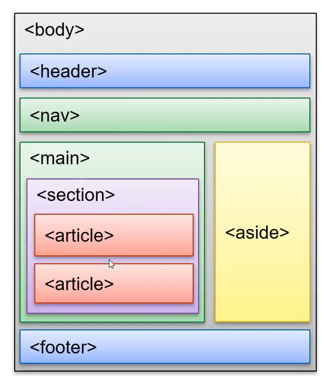
</p>

* La barra de navegación se encuentra pegada al lado derecho de la página. Voy a proceder a centrar esto y en la parte de la izquierda podemos incluir un logo del sistema.

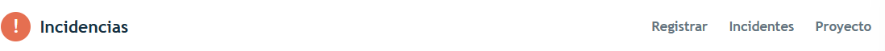

* Ya existe un botón de registrar en la barra de navegación. Me parece correcto mantener únicamente uno pero ubicado en la parte más visible, puede ser en la parte superior izquierda o derecha y que en el futuro no regrese, no solo nos lleve a la sección de registro en la misma página sino que abra una ventana tipo "pop up", **para esta idea es necesario utilizar JavaScript por lo que quedará pendiente para los enfoques de las semanas futuras.**

* En relación al registro de los incidentes, la simulación generada es correcta pues para realizar el almacenamiento de la información ingresada necesitaremos JS o, idealmente, una base de datos para tener persistencia.

* Crearemos una imagen de un sistema ficticio para nuestro proyecto y este se mostrará siempre en la parte superior izquierda y reubicaremos el título de registro de incidencias, también eliminaremos texto innecesario y reduciremos el tamaño en general de esta sección de "hero".

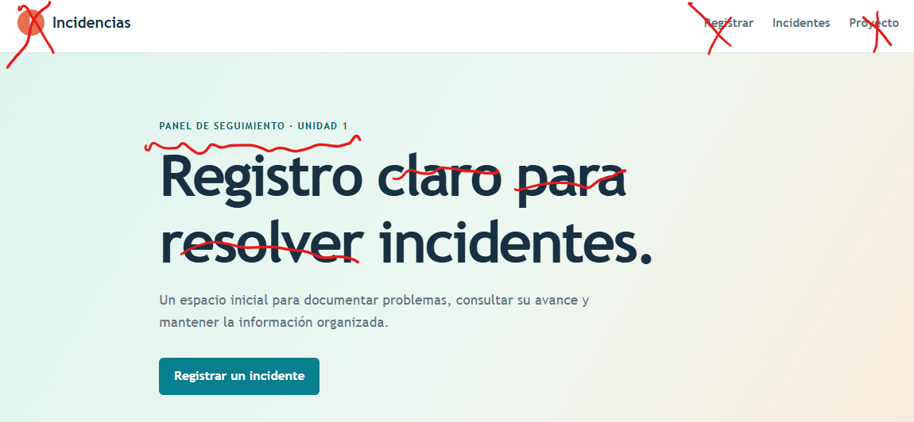

* El logo que utilizaremos será el siguiente: 

<p align="center">
    
</p>

Hay que notar que el código para este cambio refleja que es un enlace al inicio de la página. Esto realmente no es funcional por el momento hasta que podamos referenciar una página de inicio (para mi proyecto personal). 

* El contenido que se muestra en el panel lateral es responsivo y tentativamente debe mostrar una vista del ultimo ticket que haya generado el usuario. Por ahora el que se encuentra ahi esta correto, sin embargo, este elemento esta deslizandose de forma innecesaria hacia abajo conforme bajamos en la página asi que vamos a corregir este comportamiento.

## ENTREGA T1S1

En esta primera entrega hemos desarrollado el esqueleto de nuestro proyecto, la pagina web tiene una estructura sencilla y funcional de acuerdo con la lógica del proyecto a lo largo del curso y la documentacion técnica ha sido generada. Con lo desarrollado hasta este punto realizaremos el primer commit y push del proyecto. 
___

## Instrucciones T1S2

 Mejore el prototipo de la Unidad I incorporando JavaScript. Debe validar dinámicamente el formulario, renderizar incidentes simulados, consumir un archivo JSON o datos simulados con Fetch, anunciar mensajes con ARIA y organizar la lógica usando una separación tipo MVC.

## Enfoques de la mejora

* **Validar dinámicamente el formulario:** que el formulario le avise al usuario si algo está mal (un campo vacío, un correo mal escrito) mientras lo está llenando, no solo cuando intenta enviarlo.

El principal cambio aqui fue hacer que el formulario pueda s3er controlado con JavaScript, por lo que le agregamos un id para poder referenciarlo y tambien le agregamos el atributo de no validar ya que usariamos nuestros mensajes de error pesonalizados para cumplir con la validación segun las instrucciones. En este sentido, si intentamos registrar los datos ingresados en el formularios los mensajes de error se mostrarian de la siguiente manera:

<p align="center">
    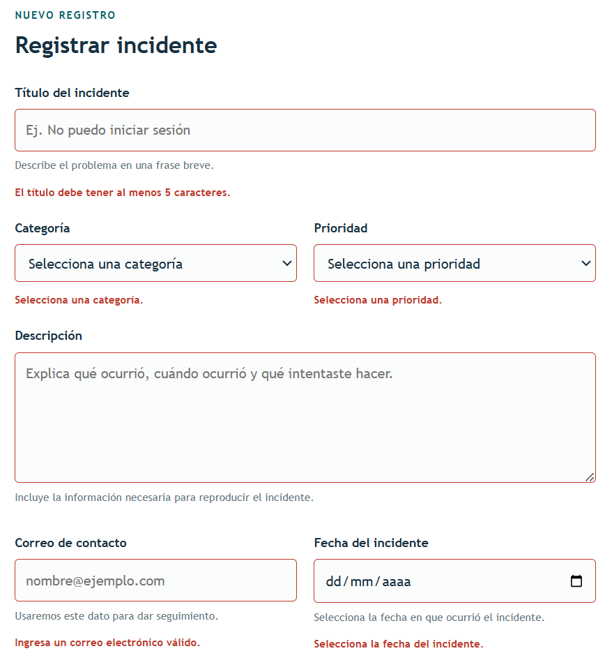
</p>

Hay que mencionar que utilizamos la propiedad "hidden" para que no se muestren por defecto estos mensajes sino hasta que falle la validacion al presionar el boton de registro. 

* **Renderizar incidentes simulados:** que la lista de incidentes ya no esté "quemada" a mano en el código, sino que aparezca en pantalla generada automáticamente a partir de los datos.

Antes, los 3 que habiamos determinado como ejemplo de como se visualizaria la página idealmente estaban escritos directamente en el HTML como texto fijo. Ahora, model.js guarda esos datos en una variable, y view.js tiene una función (renderList) que recorre esos datos con código y por cada incidente crea un bloque HTML nuevo (<article>) y lo mete en la página. El resultado es que podamos ver el registro como tal en la seccion "Incidentes  recientes" e, incluso, en el sidebar que muestra el ultimo ticket registrado (renderDetail).

**Ejemplo propuesto:**

<p align="center">
    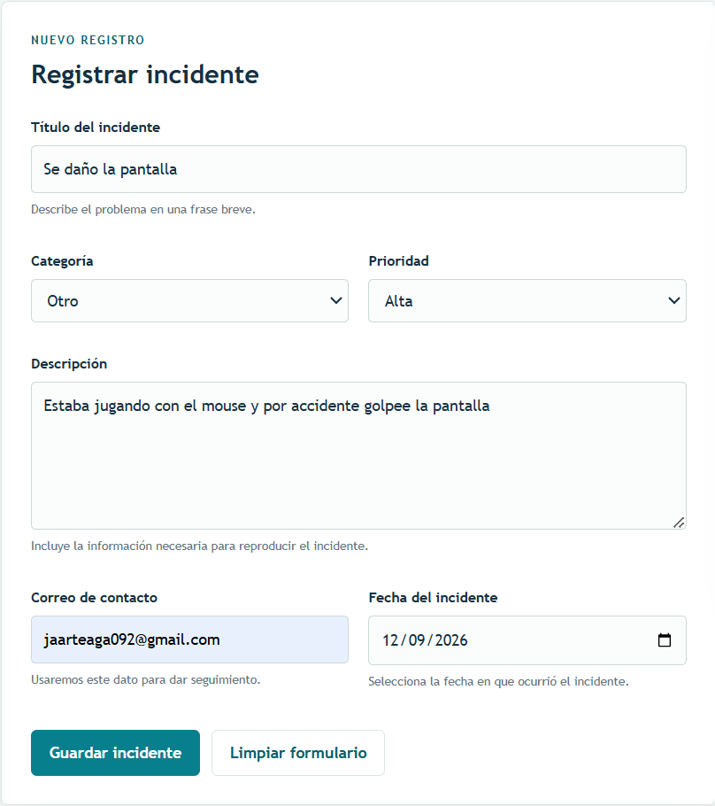
</p>

**Resultado en incidentes recientes:**

<p align="center">
    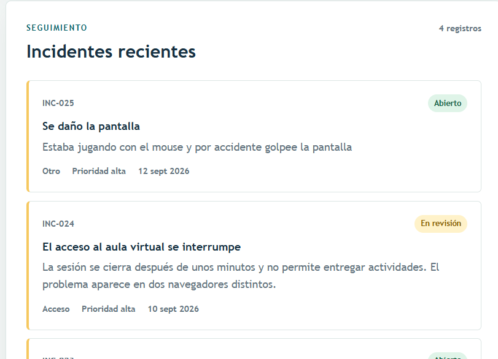
</p>

**Resultado en ultimo incidente:**

<p align="center">
    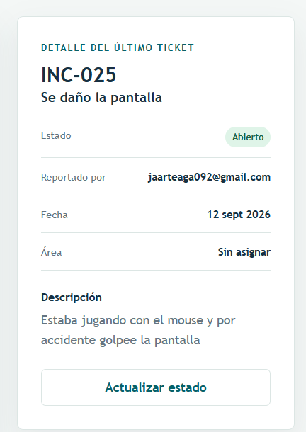
</p>

* **Consumir un JSON con Fetch:** que esos incidentes vengan de un archivo separado (como si fuera una mini base de datos), y que la página los "pida" y los cargue cuando se abre, en lugar de tenerlos escritos directamente adentro.

Creamos data/incidents.json, un archivo separado con los datos en formato JSON. En model.js, la función loadIncidents() usa fetch("data/incidents.json") para pedir ese archivo de forma **asíncrona** (como si fuera una petición a un servidor) y luego lo convierte en datos que JavaScript puede usar. Por eso necesitamos Live Serve ya que fetch no funciona abriendo el archivo con doble clic, necesita un servidor real sirviendo los archivos.

* **Anunciar mensajes con ARIA:** que cuando pase algo importante en la página (se registró un incidente, hay un error, se cargó la información), una persona que use lector de pantalla también se entere, aunque no pueda verlo.

* **Organización tipo MVC:** Nuestro proyecto se desarrolla ordenado en partes separadas según su función: una que maneja los datos, otra que maneja lo que se ve en pantalla, y otra que conecta ambas cuando el usuario hace algo. Así es más fácil de entender y de corregir después. Podemos constatar la manera en que hemos procedido hasta este momento: 

<p align="center">
    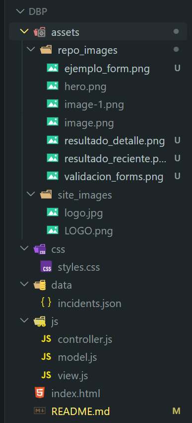
</p>

Notemos que la separacion de nuestros archivos de JS tienen el siguiente propósito:

* model.js responde: "¿cuáles son los datos?" (traerlos, guardarlos, agregar uno nuevo)
* view.js responde: "¿cómo se ve eso en pantalla?" (convertir datos en HTML)
* controller.js responde: "¿qué debe pasar cuando el usuario hace algo?" (clic, escribir, enviar) 

## ENTREGA T1S2

En esta segunda entrega hemos incorporado JavaScript al esqueleto desarrollado en la primera semana, dotando a la página web de validación dinámica, renderizado de datos mediante Fetch y anuncios accesibles con ARIA, todo organizado bajo una arquitectura tipo MVC de acuerdo con la lógica del proyecto a lo largo del curso. La documentación técnica correspondiente ha sido generada. Con lo desarrollado hasta este punto realizaremos el commit y push de esta segunda entrega.

___

## Instrucciones T1S3

Elabore un documento técnico breve y un prototipo mínimo que demuestre el flujo cliente-servidor. Debe incluir diagrama de componentes, roles, arquitectura n-capas, explicación de peticiones HTTP y un servidor básico Node.js que responda una ruta JSON.

## Enfoques de la mejora

* **Concepto de plataforma digital y componentes:** hasta la semana pasada, el proyecto funcionaba únicamente con Live Server, es decir, un servidor de archivos estáticos sin ninguna lógica detrás. Esta semana el objetivo fue incorporar un servidor propio construido con Node.js, que es lo que realmente convierte al proyecto en una plataforma con componentes diferenciados: cliente, servidor y datos, cada uno con su rol específico.

* **Servidor Node.js con módulo http nativo:** se creó el archivo app.js en la raíz del proyecto, usando únicamente el módulo http de Node (sin frameworks todavía, eso queda para la siguiente semana con Express). Este servidor es el que ahora sirve index.html, styles.css y los tres módulos de JavaScript, cumpliendo la misma función que antes hacía Live Server, pero de forma propia.

* **Servicios expuestos (rutas de la API):** se agregaron dos rutas nuevas: /api/salud, que simplemente confirma que el servidor está activo, y /api/incidentes, que lee el archivo data/incidents.json desde el servidor y lo entrega como respuesta. Estas rutas son los "servicios" de la plataforma: contratos claros mediante los cuales el cliente puede pedir información.

**Api de salud de la plataforma**

<p align="center">
    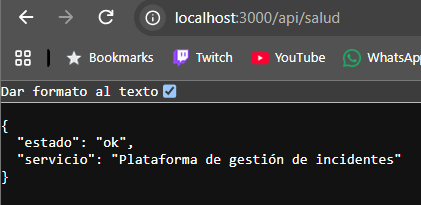
</p>

**Api de incidentes registrados**

<p align="center">
    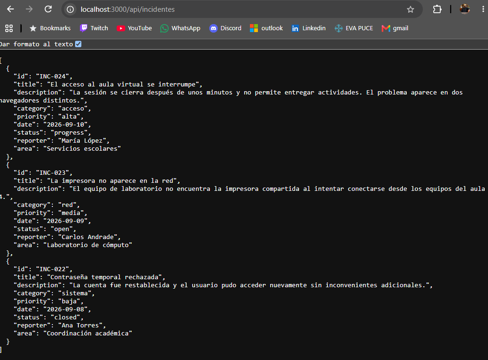
</p>

* **Cambio en el cliente (model.js):** el único ajuste necesario en el código que ya teníamos fue en model.js. Antes, loadIncidents() hacía fetch("data/incidents.json"), leyendo el archivo de forma directa. Ahora hace fetch("/api/incidentes"), pidiéndoselo al servidor en lugar de acceder al archivo directamente. view.js y controller.js no necesitaron ningún cambio, ya que no les importa de dónde vienen los datos, solo qué hacer con ellos una vez que llegan.

* **Arquitectura n-capas:** con el servidor ya en su lugar, el proyecto quedó organizado en tres capas claramente separadas: la capa de presentación (HTML, CSS y los archivos JS del cliente), la capa de lógica (app.js, que decide qué responder a cada petición) y la capa de datos (incidents.json). Como refuerzo de esta separación, el servidor bloquea el acceso directo a cualquier archivo dentro de la carpeta data, de modo que la única forma de obtener los incidentes es a través de la ruta /api/incidentes, nunca leyendo el archivo JSON de manera directa desde el navegador.

<p align="center">
    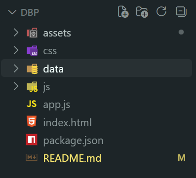
</p>

**Acceso bloqueado a la carpeta de "data"**

<p align="center">
    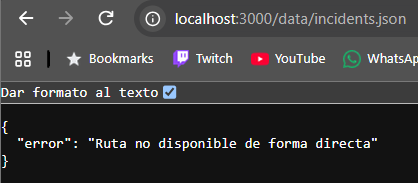
</p>

* **Peticiones HTTP:** todas las comunicaciones entre el cliente y el servidor se hacen mediante el método GET del protocolo HTTP. Cada respuesta incluye un código de estado: 200 cuando todo sale bien, y 404 cuando la ruta solicitada no existe o no está disponible (como es el caso del acceso directo a data). Se probó también una ruta inexistente para confirmar que el servidor responde con un error controlado en lugar de fallar.

<p align="center">
    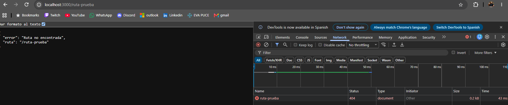
</p>

Es importante aclarar que esta semana el alcance fue únicamente demostrar el flujo cliente-servidor con peticiones GET. El formulario de registro sigue funcionando igual que en la entrega anterior: guarda el incidente en la memoria del navegador, pero no hay persistencia real todavía, ya que eso corresponde a la incorporación de Express y las rutas CRUD en la siguiente semana.

## ENTREGA T1S3

En esta tercera entrega incorporamos un servidor Node.js real al proyecto, reemplazando la función que antes cumplía Live Server. Se expusieron rutas de servicio (/api/salud y /api/incidentes), se reforzó la separación en arquitectura de n-capas restringiendo el acceso directo a los datos, y se documentó el flujo completo de peticiones HTTP entre el cliente y el servidor. La documentación técnica correspondiente ha sido generada. Con lo desarrollado hasta este punto realizaremos el commit y push de esta tercera entrega.
___

## Instrucciones T1S4

Implemente una API REST inicial para incidentes con Express y un front-end que consuma sus datos. Debe incluir rutas CRUD básicas, controladores, modelo en memoria, middleware de registro, manejo de errores y una interfaz que liste, filtre o cree incidentes mediante Fetch.

## Enfoques de mejora

Migración a Express.js: Se sustituyó el módulo http nativo por el framework Express.js, facilitando el enrutamiento modular, el procesamiento de cuerpos JSON mediante middleware nativo (express.json()) y el servicio de archivos estáticos (express.static).

Implementación de Rutas CRUD y Controladores: Se definieron endpoints RESTful completos para la entidad de incidentes (/api/incidentes):

- GET /api/incidentes: Obtención y filtrado de incidentes (por categoría, prioridad o estado).

- GET /api/incidentes/:id: Obtención del detalle de un incidente por identificador único.

- POST /api/incidentes: Creación de un nuevo incidente con asignación automática de ID y fecha.

- PUT /api/incidentes/:id: Actualización completa de la información de un incidente existente.

- DELETE /api/incidentes/:id: Eliminación física/lógica de un incidente por su ID.

**Modelo en Memoria:** Los incidentes se administran temporalmente en un arreglo de JavaScript en memoria inicializado a partir del archivo JSON, permitiendo mutaciones en tiempo de ejecución (crear, editar, eliminar) dentro de la sesión del servidor.

**Middlewares Personalizados:**

Middleware de Registro (Logger): Intercepta cada solicitud entrante imprimiendo en consola el método HTTP, la URL y la marca de tiempo.

Middleware de Manejo de Errores: Captura excepciones no controladas y devuelve respuestas JSON con código 500 Internal Server Error o validaciones de formato (400 Bad Request).

Integración con la Interfaz (Fetch API): El cliente consume dinámicamente los endpoints REST usando fetch(), permitiendo listar incidentes en tiempo real, aplicar filtros de búsqueda desde la interfaz y enviar nuevos registros sin recargar la página.

**Pruebas de endpoints CRUD con cliente HTTP: **

Aqui hicimos el ingreso de un incidente nuevamente para comprobar que el registro de hace a traves de una peticion al servidor.

<p align="center">
    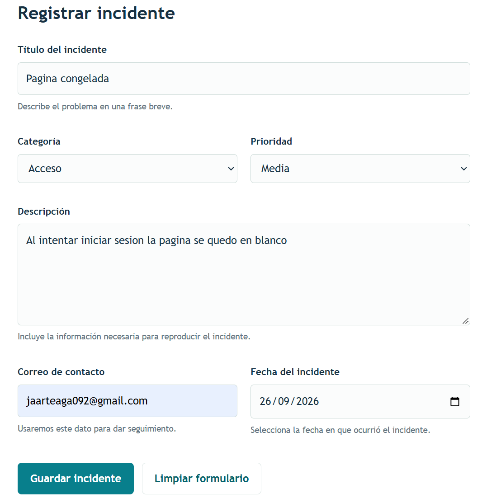
</p>

Comprobamos que el registro se realizo con una peticion de tipo POST al servidor para luego solicitar refrescar la lista que se mostraria en la pagina utilizado otra peticion, esta vez de tipo GET.

<p align="center">
    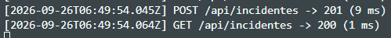
</p>

Asi mismo se implementaron filtros para, a traves de una peticion de tipo GET, encontrar los incidentes almacenados en el archiso de incidentes.json

<p align="center">
    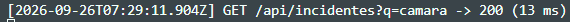
</p>

<p align="center">
    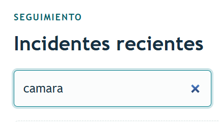
</p>

Tomar en consideracion que el hecho de que no se haya encontrado el incidente a traves del filtro, el mensaje 200 nos asegura que la peticion http se realizo de manera correcta.

A continuacion se evidencia la implementacion de lectura en el archivo model.js

```javascript
async function loadIncidents(filters = {}) {
  // Construye la URL con Query Parameters (ej: /api/incidentes?q=camara) como en el ejemplo anterior
  const queryParams = new URLSearchParams(filters).toString();
  const url = queryParams ? `/api/incidentes?${queryParams}` : '/api/incidentes';

  // Consumo asíncrono de la API REST
  const response = await fetch(url);
  if (!response.ok) throw new Error('Error al cargar incidentes');
  
  return await response.json(); // Convierte la respuesta JSON en objetos JS
}
```

Y tambien la integracion de la escritura utilizando POST

```javascript
async function createIncident(data) {
  const response = await fetch('/api/incidentes', {
    method: 'POST',
    headers: {
      'Content-Type': 'application/json' // Indica al backend que envía un JSON
    },
    body: JSON.stringify(data) // Transforma el objeto JS a cadena JSON
  });

  if (!response.ok) throw new Error('Error al registrar el incidente');
  return await response.json(); // Retorna el incidente creado con su ID
}
```
Tenemos tambien una simple implementacion de actualizacion utilizando peticiones PUT/PATCH con la posibilidad de cambiar el estado del ultimo ticket

## ENTREGA T1S4

En esta cuarta entrega consolidamos la integración entre el cliente web y el backend Express mediante una API RESTful completa. Se implementaron las peticiones asíncronas (GET, POST) utilizando Fetch API bajo el patrón MVC, asegurando el refresco dinámico de datos sin recargar la página. Además, se integraron middlewares de registro para auditoría de tráfico y control centralizado de errores, garantizando respuestas JSON con códigos HTTP adecuados (201, 200, 404). Se completó la modularización del proyecto respaldada por package.json y el control de versiones. Con lo desarrollado hasta este punto realizaremos el commit y push de esta cuarta entrega.

___
## Instrucciones T1S5

Amplíe la plataforma de incidentes del Reto 2. Reemplace el almacenamiento en memoria por una base de datos. Implemente conexión segura mediante variables de entorno, un modelo de Incidente, migraciones, CRUD persistente, filtros por estado o prioridad, validaciones y manejo central de excepciones. Pruebe los casos correctos y los errores. Entregue el código, el esquema, las migraciones, capturas de la base y un informe de 700 a 900 palabras que explique sus decisiones.

## Enfoques de mejora

**Base de datos elegida:** PostgreSQL 16 (SQL) ejecutándose en Docker, con el ORM **Sequelize**. Los incidentes tienen una estructura fija (título, prioridad, estado...), por eso un modelo relacional con restricciones es más adecuado que uno NoSQL de documentos.

| Antes (T1S4) | Ahora (T1S5) |
|---|---|
| Arreglo en memoria: se pierde al reiniciar | Tabla `incidents` en PostgreSQL: los datos persisten |
| Validación manual en el controlador | Validaciones en el modelo ORM + restricciones `CHECK` en la base |
| Funciones síncronas | Funciones `async/await` (la base responde por red) |
| Errores 400/404/500 | Manejo central: 400, 404, 409, 413, 500 y 503 según el tipo de excepción |

**Estructura nueva**

```
.env.example                 plantilla de variables (el .env real NO se sube a Git)
docker-compose.yml           PostgreSQL + Adminer (+ API opcional para el servidor)
Dockerfile                   imagen de la API para Ubuntu Server
.sequelizerc                 rutas que usa sequelize-cli
database/esquema.sql         esquema final de la tabla (pg_dump)
migrations/                  001 crea la tabla y CHECKs, 002 agrega índices
seeders/                     incidentes de ejemplo
scripts/pruebas.js           23 pruebas: casos correctos, errores y seguridad
src/config/config.js         lee la conexión desde variables de entorno
src/db/sequelize.js          crea el pool de conexiones
src/models/Incident.js       modelo ORM con validaciones
src/models/incidentModel.js  consultas (findAll, findByPk, create, save, destroy)
src/middleware/asyncHandler.js  envía los errores async al manejador central
```

**Seguridad aplicada**
- Credenciales solo en `.env` (ignorado por Git) y la app no arranca si faltan.
- PostgreSQL publicado solo en `127.0.0.1`: no queda expuesto a la red.
- Consultas parametrizadas del ORM: la búsqueda `' OR '1'='1` devuelve 0 resultados.
- Lista blanca de campos (evita asignación masiva) y validación del `id` y de los filtros.
- Escape de HTML en la vista para evitar XSS almacenado, ahora que los datos se guardan.
- Los errores no revelan SQL ni el stack trace al cliente; el detalle queda en el log.
- `express.json({ limit: "10kb" })` y `x-powered-by` desactivado.

## Cómo ejecutar en desarrollo (PC con Docker Desktop)

```bash
cp .env.example .env          # y cambiar DB_PASSWORD
docker compose up -d db adminer
npm install
npm run db:migrate            # crea la tabla
npm run db:seed               # carga datos de ejemplo
npm start                     # http://localhost:3000
npm run probar                # en otra terminal: ejecuta las 29 pruebas
```

## Despliegue en el servidor Ubuntu con Docker

El servidor se usaba originalmente como NAS de un proyecto de homelab, para guardar archivos e imágenes con Immich. Ahora también aloja la plataforma de incidentes. Docker Compose la levanta con una red y un volumen propios, así que las dos bases PostgreSQL conviven en el mismo equipo sin compartir datos ni credenciales.

### 1. Publicación del código (PC, Git Bash)

```bash
git add .
git commit -m "Quinta entrega: persistencia con PostgreSQL, Sequelize, migraciones y Docker"
git push origin main
```

### 2. Acceso y verificación del servidor

Se accedió por SSH y se comprobó que Docker y Docker Compose ya estaban instalados. Luego se actualizó el sistema.

```bash
ssh usuario@IP_DEL_SERVIDOR
lsb_release -a
docker --version && docker compose version
sudo apt update && sudo apt upgrade -y
```

<p align="center">
    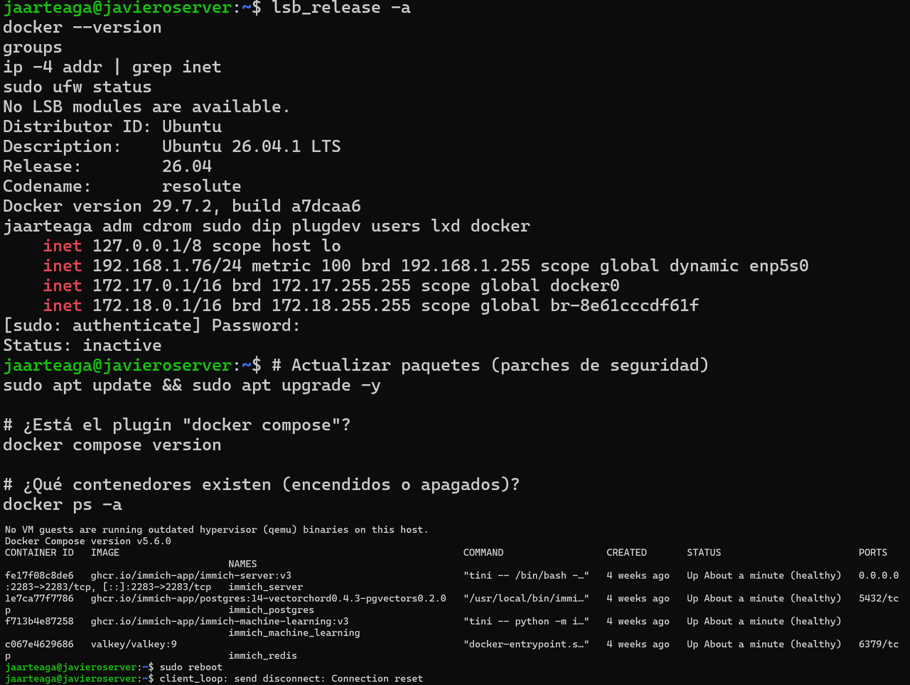
</p>

### 3. Proyecto y variables de entorno

Se clonó el repositorio y se creó un `.env` exclusivo del servidor, con una contraseña aleatoria distinta a la de desarrollo y permisos de lectura solo para el propietario.

```bash
git clone https://github.com/javieroel/DBP.git && cd DBP
cp .env.example .env
sed -i "s/cambie_esta_clave/$(openssl rand -hex 24)/" .env
chmod 600 .env
grep -v PASSWORD .env
```

<p align="center">
    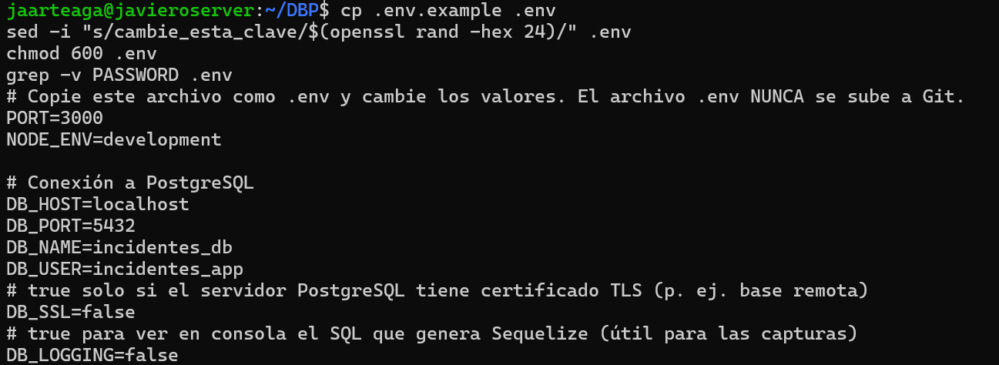
</p>

### 4. Contenedores y migraciones

Con un solo comando se levantaron PostgreSQL, Adminer y la API. La base y Adminer solo escuchan en `127.0.0.1`, así que únicamente la API (puerto 3000) es accesible desde la red. Al arrancar, la API aplicó las migraciones y se conectó a PostgreSQL.

```bash
docker compose --profile full up -d --build
docker compose ps
docker compose logs app
```

<p align="center">
    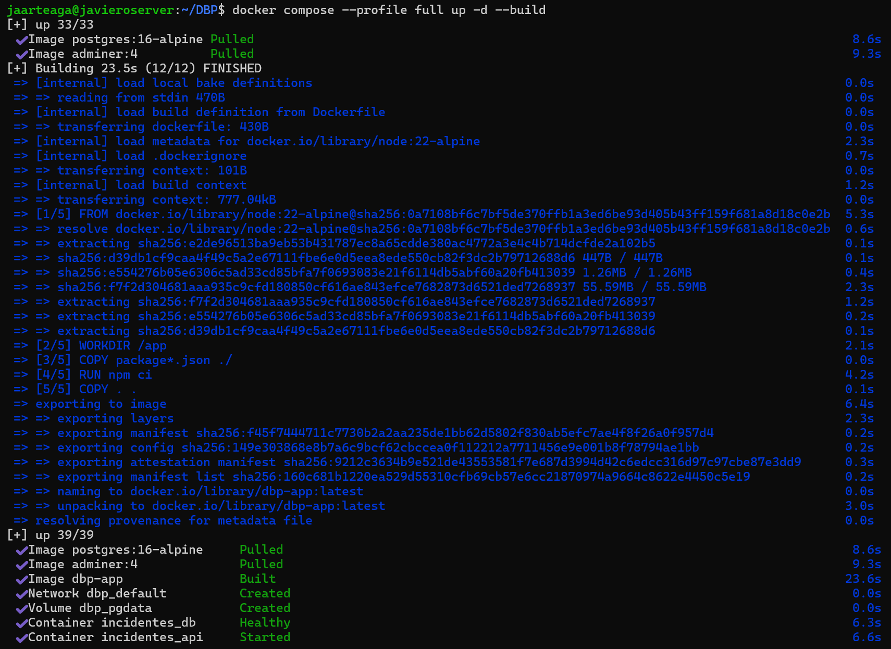
</p>

<p align="center">
    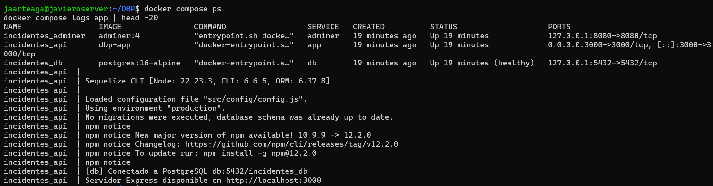
</p>

### 5. Datos de ejemplo y verificación de la base

```bash
docker compose exec app npx sequelize-cli db:seed:all
docker compose exec db psql -U incidentes_app -d incidentes_db -c "\d incidents"
```

<p align="center">
    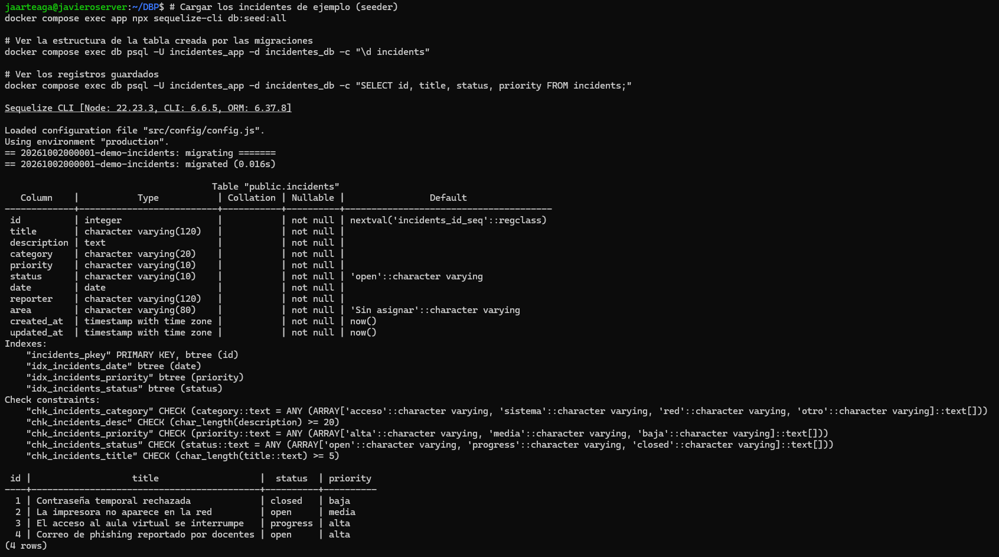
</p>

### 6. Registro desde la interfaz

Desde el navegador del PC (`http://IP_DEL_SERVIDOR:3000`) se registró el incidente INC-005. La API respondió `201 Created` y el estado "Abierto" lo asignó la base por defecto.

<p align="center">
    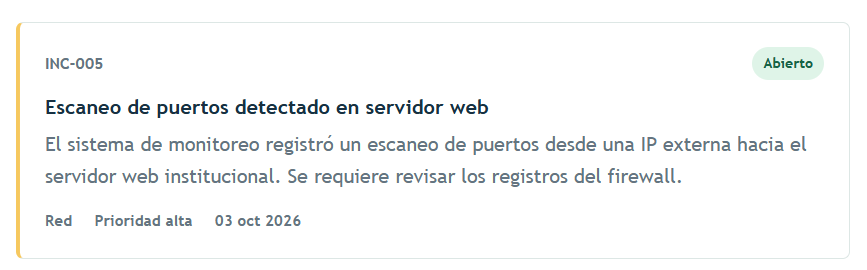
</p>

### 7. Prueba de persistencia

Se eliminaron los contenedores y se volvieron a crear. El volumen `dbp_pgdata` se conservó, y con él el incidente INC-005.

```bash
docker compose --profile full down
docker volume ls | grep pgdata
docker compose --profile full up -d
docker compose exec db psql -U incidentes_app -d incidentes_db -c "SELECT id, title, status, priority FROM incidents ORDER BY id;"
```

<p align="center">
    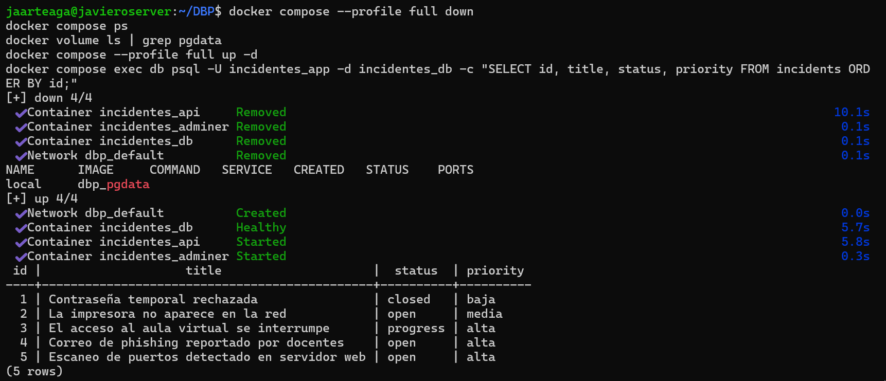
</p>

### 8. Pruebas de la API y manejo de errores

```bash
API_URL=http://IP_DEL_SERVIDOR:3000 npm run probar    # desde el PC
docker compose stop db                                # en el servidor
curl -i http://localhost:3000/api/salud               # responde 503
docker compose start db
```

<p align="center">
    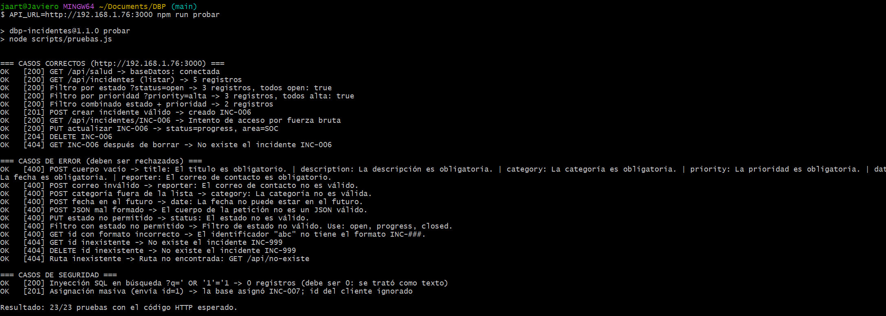
</p>

<p align="center">
    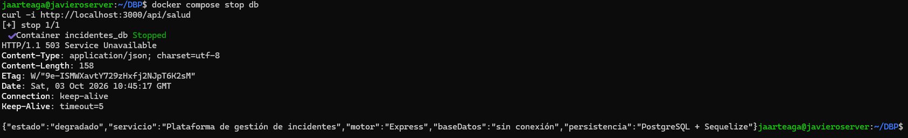
</p>

### Comandos útiles de migraciones

```bash
npm run db:migrate:status     # qué migraciones están aplicadas
npm run db:migrate:undo       # revierte la última
npm run db:reset              # revierte todo, migra y siembra de nuevo
```

> Importante: `docker compose down -v` borra también el volumen con los datos.

## ENTREGA T1S5

En esta quinta entrega se reemplazó el modelo en memoria por PostgreSQL ejecutándose en Docker, accedido mediante el ORM Sequelize. Se definió el modelo `Incident` con validaciones, dos migraciones versionadas, un seeder, CRUD persistente con filtros por estado y prioridad, conexión configurada por variables de entorno y un manejador central que traduce cada excepción a su código HTTP. La plataforma se desplegó con Docker en el servidor Ubuntu del homelab y se comprobó que los datos persisten al recrear los contenedores. Con lo desarrollado hasta este punto realizaremos el commit y push de esta quinta entrega.

___

## Mejoras por retroalimentación: cambio de estado (PATCH) y eliminación (DELETE)

### Observación del docente

> "El front-end consume la API y opera el listado, el alta y la edición Sin embargo, no ofrece controles de cambio de estado ni de eliminación, de modo que el PATCH y el DELETE que expone el servidor quedan sin uso desde el cliente. Sugerencia: agregar los botones de estado y borrado por incidente."

### Qué se implementó

Cada incidente tiene ahora botones de acción, tanto en su tarjeta como en el panel de detalle. Las operaciones viajan por HTTP hasta la API y se guardan en PostgreSQL.

| Estado actual | Botones disponibles |
|---|---|
| Abierto | Ver detalle · Pasar a revisión · Marcar resuelto · Eliminar |
| En revisión | Ver detalle · Devolver a abierto · Marcar resuelto · Eliminar |
| Resuelto | Ver detalle · Eliminar |

| Acción en la interfaz | Petición HTTP | Respuesta | Sentencia en la base |
|---|---|---|---|
| Pasar a revisión / Marcar resuelto / Devolver a abierto | `PATCH /api/incidentes/INC-###` con `{"status": "..."}` | `200 OK` + incidente actualizado | `UPDATE incidents SET status = ...` |
| Eliminar → Confirmar eliminación | `DELETE /api/incidentes/INC-###` | `204 No Content` | `DELETE FROM incidents WHERE id = ...` |

**Decisiones de diseño**

- `PATCH` modifica solo los campos enviados y es el que usan los botones. `PUT` reemplaza el incidente completo: si faltan campos obligatorios responde `400` y sugiere usar `PATCH`.
- **Regla de negocio en el servidor.** Antes de cambiar el estado, el controlador consulta el registro actual en la base. **Un incidente resuelto no puede reabrirse**; si se intenta, aunque sea con una petición manual que salte la interfaz, la API responde `409 Conflict`.

  | Desde | Puede pasar a |
  |---|---|
  | `open` | `progress`, `closed` |
  | `progress` | `open`, `closed` |
  | `closed` | (ninguno) |

- **Eliminación con confirmación en dos pasos.** El primer clic convierte el botón en "Confirmar eliminación" y el segundo borra; si no se confirma en 5 segundos, vuelve a su estado inicial. No se usan ventanas emergentes y el resultado se anuncia con la región ARIA `live-region`.
- **Accesibilidad.** Las tarjetas dejaron de ser `role="button"`, porque un botón no puede contener otros botones. Ahora cada acción es un `<button>` real, accesible con teclado, agrupado en `role="group"` con `aria-label`.

### Implementación

| Archivo | Qué se agregó |
|---|---|
| `src/routes/incidentRoutes.js` | `router.patch("/:id", incidentController.patchIncident)` |
| `src/models/incidentModel.js` | `STATUS_TRANSITIONS` y `canChangeStatus()`: estados permitidos desde cada estado |
| `src/controllers/incidentController.js` | `patchIncident` (cambio parcial), `updateIncident` (PUT exige todos los campos) y `checkStatusChange()` (responde 409) |
| `js/model.js` | `patchIncident()` y `deleteIncident()` con `fetch` (`method: "PATCH"` / `"DELETE"`) |
| `js/view.js` | `actionsHtml()`: botones según el estado; `askDeleteConfirmation()` |
| `js/controller.js` | `handleAction()`: un solo manejador para ver detalle, cambiar estado y eliminar |
| `scripts/pruebas.js` | 6 pruebas nuevas (PATCH, PUT incompleto, 409, PATCH sin campos o inexistente): 29 en total |

Fragmento clave (regla de negocio en `src/models/incidentModel.js`):

```js
const STATUS_TRANSITIONS = {
  open: ["progress", "closed"],
  progress: ["open", "closed"],
  closed: []            // un incidente resuelto no se reabre -> 409 Conflict
};
```

### Evidencias

<p align="center">
    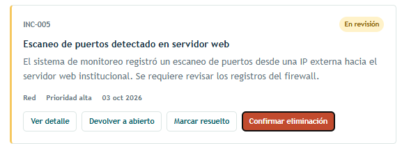
    <br><em>Figura R1. Botones de estado y eliminación en cada incidente.</em>
</p>

Resultado al cargar la pagina y marcar un incidente como resuelto u luego eliminarlo, evidenciando el uso de PATCH y DELETE cuando solo se actualiza el incidente como tal o se elimina por completo. En este caso actualizamos el incidente 4 y eliminamos el 5 que ya se habia marcado como resuelto. 

<p align="center">
    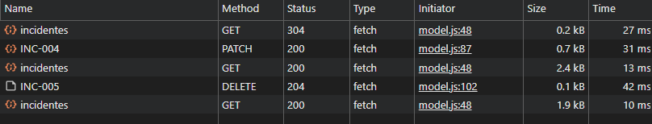
    <br><em>Figura R2. Desde la interfaz, "Marcar resuelto" envía un PATCH (200 OK) y "Eliminar" envía un DELETE (204 No Content).</em>
</p>

### Cómo actualizar el servidor después de los cambios

**1. En el PC (utilizando GIT Bash en mi caso):**

```bash
git add src js css scripts README.md
git commit -m "Retroalimentación: PATCH y DELETE desde la interfaz y regla de transición de estados"
git push origin main
```

**2. En el servidor (por SSH, ya que tengo un servidor local que es funcional y esta ya configurado con postgreSQL):**

```bash
ssh usuario@IP_DEL_SERVIDOR
cd ~/DBP
git pull                                       # trae el código nuevo
docker compose --profile full up -d --build    # reconstruye la API y levanta todo
docker compose ps                              # los tres contenedores "Up", la base "(healthy)"
docker compose logs app --tail 5               # "Conectado a PostgreSQL" y "Servidor Express disponible"
```

**3. En el navegador:** `http://IP_DEL_SERVIDOR:3000`, con **Ctrl + F5** para no usar el JavaScript guardado en caché.

> El front y el back se levantan juntos: el contenedor `incidentes_api` ejecuta `app.js`, que sirve la interfaz (`express.static`) y la API (`/api/incidentes`).

> Si un contenedor se detuvo con `docker compose stop`, `restart: unless-stopped` no lo vuelve a encender, ni siquiera tras reiniciar el servidor. `docker compose --profile full up -d` lo levanta de nuevo.

### Consultar la base de datos

Desde el servidor (por SSH), dentro de `~/DBP`:

```bash
docker compose exec db psql -U incidentes_app -d incidentes_db
```

```sql
\dt                                                    -- tablas: incidents, sequelize_meta, sequelize_data
SELECT * FROM sequelize_meta;                          -- migraciones aplicadas
SELECT id, title, status FROM incidents ORDER BY id;   -- registros
\q                                                     -- salir
```

No pide contraseña porque `docker compose exec` entra al propio contenedor de la base, y PostgreSQL confía en sus conexiones locales. Desde la red no es posible: el puerto 5432 solo escucha en `127.0.0.1` del servidor.

| Prompt | Dónde se está | Uso |
|---|---|---|
| `PS C:\...>` o `MINGW64` | PC | git, npm, abrir SSH |
| `usuario@servidor:~/DBP$` | Servidor | git pull, docker compose |
| `incidentes_db=#` | Dentro de PostgreSQL | SQL y comandos `\` |

Toda esta información ayuda como una guía preliminar y breve de como se debe administrar la plataforma y de esta manera, ya podemos hacer consultas con SQL para explorar el contenido almacenado o generado por la misma.
___

## Instrucciones T1S6

Fortalezca la plataforma de incidentes. Proteja rutas con JWT y roles, aplique hash de contraseñas, configure CORS, documente HTTPS, valide y limpie entradas. Integre el cliente con la API y pruebe crear, consultar, actualizar y eliminar. Registre al menos ocho casos, incluidos accesos sin token, permisos insuficientes y datos inválidos. Entregue código, evidencias y un informe de 800 a 1000 palabras con fallos encontrados y mejoras realizadas.

## Fallos encontrados

| # | Fallo en la versión anterior | Riesgo |
|---|---|---|
| 1 | La API no pedía identificación: cualquier equipo de la red podía crear, modificar o borrar incidentes | Control de acceso roto (OWASP A01) |
| 2 | No existían roles: todos podían hacer todo | Escalada de privilegios |
| 3 | El texto con HTML (`<script>`, ``) se guardaba tal cual; solo lo frenaba el escape de la vista | XSS almacenado |
| 4 | Sin cabeceras de seguridad (CSP, X-Frame-Options, nosniff) | XSS, clickjacking |
| 5 | Sin política CORS explícita | Uso de la API desde sitios no autorizados |
| 6 | Tráfico en HTTP plano | Credenciales y tokens legibles en la red |

## Mejoras realizadas

| Mejora | Dónde |
|---|---|
| **Login con JWT** (HS256, expira en 1 h, emisor y audiencia verificados; se rechaza `alg: none`) | `src/services/authService.js`, `src/routes/authRoutes.js` |
| **Contraseñas con hash bcrypt** (12 rondas). La tabla `users` solo guarda el hash; un `CHECK` impide texto plano | `migrations/20261009000003-create-users.js`, `seeders/20261009000002-demo-users.js` |
| **Mismo mensaje para correo inexistente o contraseña incorrecta**, con comparación contra un hash de relleno para no revelar qué correos existen | `src/services/authService.js` |
| **Límite de intentos de login**: 10 fallos por IP cada 15 minutos (`429`) | `src/routes/authRoutes.js` |
| **Rutas protegidas con token** (`401`) **y roles** (`403`) | `src/middleware/auth.js`, `src/routes/incidentRoutes.js` |
| **Limpieza de entradas**: quita etiquetas HTML, caracteres de control y claves `__proto__` antes de validar (la contraseña no se modifica) | `src/middleware/sanitize.js` |
| **CORS**: solo la propia interfaz y los orígenes de `CORS_ORIGINS`; el resto recibe `403` | `app.js` |
| **Cabeceras de seguridad con Helmet** (CSP, X-Frame-Options, nosniff, Referrer-Policy; HSTS con HTTPS) | `app.js` |
| **HTTPS con Caddy** como proxy inverso (perfil opcional) | `deploy/Caddyfile`, `docker-compose.yml` |
| **Cliente integrado**: inicio y cierre de sesión, token en cada `fetch`, botones según el rol y cierre automático de sesión ante un `401` | `index.html`, `js/model.js`, `js/view.js`, `js/controller.js` |

### Roles y permisos

| Acción | Ruta | admin | analista | lector |
|---|---|:-:|:-:|:-:|
| Consultar | `GET /api/incidentes`, `GET /api/incidentes/:id` | ✅ | ✅ | ✅ |
| Crear | `POST /api/incidentes` | ✅ | ✅ | ❌ 403 |
| Cambiar estado | `PATCH /api/incidentes/:id` | ✅ | ✅ | ❌ 403 |
| Reemplazar | `PUT /api/incidentes/:id` | ✅ | ❌ 403 | ❌ 403 |
| Eliminar | `DELETE /api/incidentes/:id` | ✅ | ❌ 403 | ❌ 403 |

Sin token, o con un token inválido, cualquier ruta de incidentes responde `401`. `GET /api/salud` y `POST /api/auth/login` son públicas.

### Casos de prueba registrados

El script `npm run probar` ejecuta 39 casos. Estos son los más representativos:

| # | Caso | Esperado | Obtenido |
|---|---|:-:|:-:|
| 1 | Consultar incidentes sin token | 401 | 401 |
| 2 | Token firmado con otra clave (rol admin falso) | 401 | 401 |
| 3 | Token sin firma (`alg: none`) | 401 | 401 |
| 4 | Token de lector modificado a rol admin | 401 | 401 |
| 5 | Login con contraseña incorrecta | 401 | 401 |
| 6 | Lector intenta crear un incidente | 403 | 403 |
| 7 | Analista intenta eliminar un incidente | 403 | 403 |
| 8 | Crear con correo y categoría inválidos | 400 | 400 |
| 9 | Título con `<script>` | 201, guardado sin etiquetas | 201 |
| 10 | Búsqueda con `' OR '1'='1` | 200, 0 resultados | 200 |
| 11 | Petición desde un origen no autorizado (CORS) | 403 | 403 |
| 12 | CRUD completo con los roles correctos | 201 / 200 / 200 / 204 | ✅ |

### Mejoras de experiencia de usuario

- **Detalle del ticket fijo al desplazarse:** el panel de detalle de la barra lateral usa `position: sticky`, así que acompaña al usuario mientras recorre la lista de incidentes. Si el detalle es más alto que la pantalla, tiene su propio desplazamiento (`max-height` + `overflow-y: auto`). En pantallas pequeñas vuelve a su posición normal.
- **Interfaz más limpia:** se eliminó el recuadro estático "Próximo paso", que no aportaba información del incidente.

### Evidencias

<p align="center">
    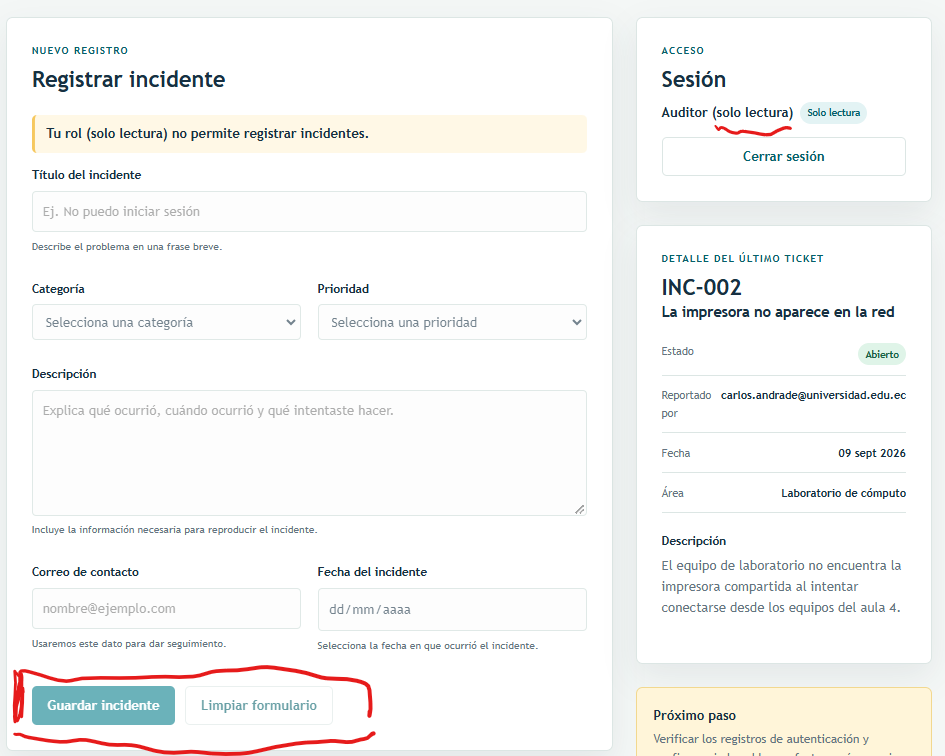
    <br><em>Figura S1. Integración cliente-API: con el rol lector el formulario se bloquea y solo se puede consultar.</em>
</p>

<p align="center">
    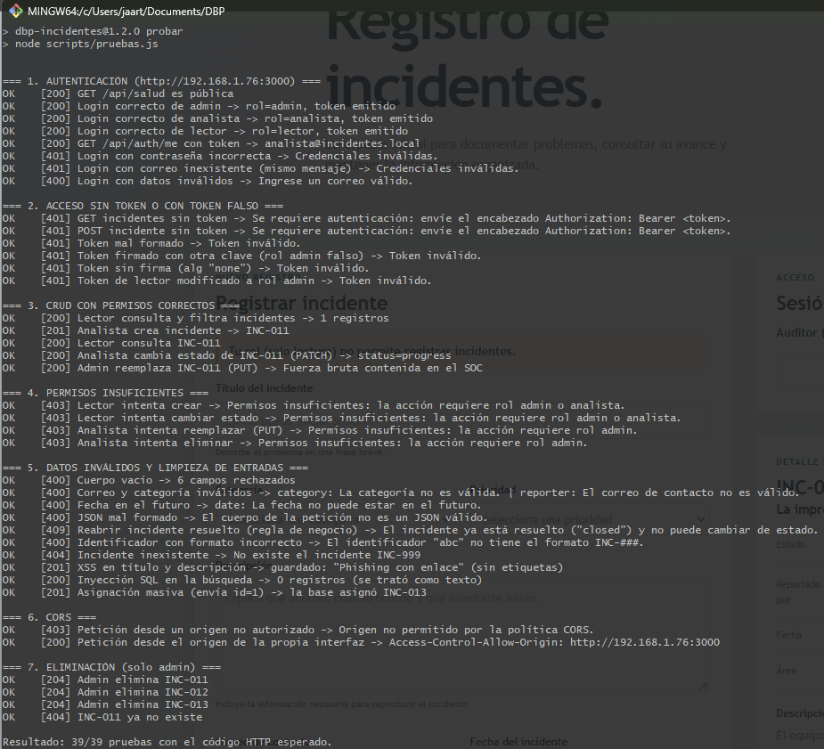
    <br><em>Figura S2. Pruebas contra el servidor: accesos sin token (401), permisos insuficientes (403), datos inválidos (400) y CORS (403).</em>
</p>

<p align="center">
    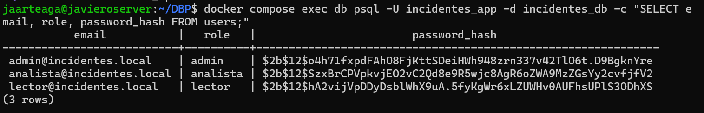
    <br><em>Figura S3. Las contraseñas se almacenan como hash bcrypt, nunca en texto plano.</em>
</p>

## HTTPS

La aplicación habla HTTP en el puerto 3000. Para cifrar el tráfico se añadió **Caddy** como proxy inverso: el navegador se conecta por HTTPS (puerto 443) a Caddy, y Caddy reenvía la petición a la API por la red interna de Docker.

```
Navegador ──HTTPS:443──> Caddy ──HTTP (red interna de Docker)──> API :3000 ──> PostgreSQL
```

- `tls internal`: Caddy crea su propia autoridad certificadora (CA) local, adecuada para una red de casa o de laboratorio. El navegador avisará hasta que se instale el certificado raíz de esa CA.
- En un servidor con dominio público basta con quitar `tls internal` y poner el dominio en `SITE_ADDRESS`: Caddy obtiene y renueva solo un certificado de Let's Encrypt.
- Con `HTTPS_PROXY_ENABLED=true` la API añade **HSTS** (obliga al navegador a usar siempre HTTPS) y la directiva CSP `upgrade-insecure-requests`.
- Con `APP_PORT=127.0.0.1:3000` el puerto HTTP deja de estar expuesto a la red; solo se entra por HTTPS.

```bash
# en .env: HTTPS_PROXY_ENABLED=true, APP_PORT=127.0.0.1:3000, SITE_ADDRESS=IP_DEL_SERVIDOR
docker compose --profile full --profile https up -d --build
# Abrir https://IP_DEL_SERVIDOR
# Certificado raíz para instalarlo en el PC (opcional, quita el aviso del navegador):
docker compose cp caddy:/data/caddy/pki/authorities/local/root.crt ./caddy-root.crt
```

## Actualización del servidor para la Unidad 6

```bash
cd ~/DBP && git pull

# Agregar al .env las variables nuevas (la clave JWT se genera aleatoria)
cat >> .env <<EOF2
JWT_SECRET=$(openssl rand -hex 32)
JWT_EXPIRES_IN=1h
CORS_ORIGINS=http://IP_DEL_SERVIDOR:3000
HTTPS_PROXY_ENABLED=false
SEED_ADMIN_PASSWORD=<clave-admin>
SEED_ANALISTA_PASSWORD=<clave-analista>
SEED_LECTOR_PASSWORD=<clave-lector>
EOF2

docker compose --profile full up -d --build           # aplica la migración 3 (tabla users)
docker compose exec app npx sequelize-cli db:seed:all  # crea los 3 usuarios con hash bcrypt
```

Reemplace cada `<clave-...>` por una contraseña real de al menos 10 caracteres. Usuarios creados: `admin@incidentes.local`, `analista@incidentes.local` y `lector@incidentes.local`, con las contraseñas del `.env` del servidor (que nunca se sube a Git).

Ejecutar las pruebas desde el PC:

```bash
API_URL=http://IP_DEL_SERVIDOR:3000 ADMIN_PASSWORD=... ANALISTA_PASSWORD=... LECTOR_PASSWORD=... npm run probar
```

## ENTREGA T1S6

En esta sexta entrega la plataforma pasó de una API abierta a una API protegida: autenticación con JWT, contraseñas con hash bcrypt, autorización por roles, limpieza y validación de entradas, política CORS, cabeceras de seguridad y HTTPS mediante Caddy. El cliente web se integró con este esquema (inicio de sesión, token en cada petición y botones según el rol) y se mejoró la experiencia de usuario manteniendo visible el detalle del ticket. 39 casos de prueba verifican el funcionamiento correcto y el rechazo de accesos sin token, permisos insuficientes y datos inválidos.

___

## Instrucciones T1S7

Revise la plataforma de incidentes. Documente y corrija al menos dos defectos con DevTools; implemente pruebas unitarias para reglas de negocio; configure ESLint y atienda su reporte; mida una consulta, una imagen y una solicitud de red; aplique mejoras verificables; refactorice un módulo bajo MVC y actualice el README. Entregue código, reportes, capturas y un informe de 800 a 1000 palabras con resultados antes y después.

## Resumen de resultados (antes → después)

| Área | Antes | Después |
|---|---|---|
| Defecto 1: doble clic en "Guardar" con red lenta | 2 `POST` → incidente duplicado | 1 `POST`; el botón se bloquea ("Guardando…") |
| Defecto 2: fecha futura en el formulario | Solo la rechazaba el servidor (`400`) | Validación en el navegador + atributo `max`; no se envía la petición |
| ESLint | 10 problemas (10 errores) | 0 problemas (1 regla justificada) |
| Pruebas unitarias (Jest) | No existían | 48 pruebas, 3 suites, 83,8 % de sentencias cubiertas |
| Consulta `?q=` sobre 20 000 filas (servidor) | 46,19 ms (`Seq Scan`) | 0,08 ms (`Bitmap Index Scan`, pg_trgm) |
| Imagen del logo (transferido) | `LOGO.png` 440×440, 211 kB | `logo-64.webp` 64×64, 10,4 kB (−95 %) |
| Carga de la página (servidor, 4G lenta) | 258,5 kB | 38,2 kB (−85 %); favicon 404 → 200 |
| `GET /api/incidentes` | 3,1 kB | 1,7 kB con compresión |

Los reportes completos están en la carpeta `reportes/`.

## 1. Depuración con DevTools

**Defecto 1: envío repetido del formulario.**
- **Pasos:** iniciar sesión como analista, abrir DevTools → Red, limitar la red a "4G lenta", llenar el formulario y pulsar dos veces "Guardar incidente".
- **Esperado:** un incidente. **Obtenido:** dos `POST /api/incidentes` con `201` y dos incidentes iguales.
- **Causa:** `handleSubmit` (`js/controller.js`) no impedía un segundo envío mientras el primero seguía en curso.
- **Corrección:** una bandera `submitting` y `IncidentView.setSubmitting()` (`js/view.js`), que deshabilita el botón, muestra "Guardando…" y marca el formulario con `aria-busy`.

**Defecto 2: fecha futura aceptada por el formulario.**
- **Pasos:** elegir una fecha posterior a hoy y guardar.
- **Obtenido:** la petición llegaba al servidor y volvía `400`, sin aviso junto al campo.
- **Causa:** el validador del cliente solo comprobaba que la fecha no estuviera vacía.
- **Corrección:** el validador compara con la fecha local de hoy y el campo recibe `max` al iniciar. La validación del servidor se mantiene.

**Defecto menor:** el navegador pedía `/favicon.ico` y recibía `404` (visible en Console). Se añadió `favicon-32.png`.

## 2. Pruebas unitarias con Jest

```bash
npm test                 # ejecuta las pruebas
npm run test:cobertura   # con reporte de cobertura
```

| Archivo | Qué prueba |
|---|---|
| `tests/incidentService.test.js` | Transiciones de estado (reabrir un resuelto → 409), formato `INC-###`, filtros y paginación, campos obligatorios de PUT y casos de uso con el modelo simulado (`jest.mock`) |
| `tests/security.test.js` | Limpieza de entradas, JWT (rol modificado, `alg: none`, otra clave) y middlewares `authenticate` / `authorize` |
| `tests/errorHandler.test.js` | Cada excepción con su código (400, 404, 409, 500, 503), sin revelar mensajes internos |

Las pruebas unitarias no usan la base de datos: el modelo se reemplaza por funciones simuladas. Las pruebas de integración contra el servidor siguen en `npm run probar` (39 casos).

## 3. Análisis estático con ESLint

```bash
npm run lint       # reporta
npm run lint:fix   # corrige automáticamente lo seguro
```

Configuración en `eslint.config.js`: reglas recomendadas más `eqeqeq`, `no-var`, `prefer-const` y `no-unused-vars`, con entornos separados para Node (back-end) y navegador (front-end).

| Hallazgo | Cantidad | Tratamiento |
|---|:-:|---|
| Variable de `catch` sin usar | 5 | Se usa `catch {}` sin variable (ES2019) |
| Objetos del patrón módulo (`IncidentModel`, `IncidentView`, `IncidentController`) declarados como globales y redeclarados | 4 | Cada archivo los exporta con `/* exported */` y solo el controlador los recibe como globales de solo lectura |
| Caracteres de control en una expresión regular (`sanitize.js`) | 1 | **Justificado**: eliminarlos es el objetivo de esa función. Se desactiva solo esa línea, con el motivo escrito |

## 4. Rendimiento

**Consulta.** `npm run medir:consulta` (en el servidor: `docker compose exec app npm run medir:consulta`) ejecuta `EXPLAIN ANALYZE` de las consultas reales de la API sobre 20 000 filas temporales dentro de una transacción que se revierte, así que la base no cambia. La **migración 4** reemplaza los índices simples por índices compuestos que siguen el orden de la consulta e índices de trigramas (`pg_trgm`) para la búsqueda de texto.

| Consulta | Antes | Después |
|---|---|---|
| Listado (`ORDER BY date DESC, id DESC LIMIT 100`) | 0,16 ms · Incremental Sort + Index Scan | 0,10 ms · Index Scan |
| Filtro `status = 'open'` | 0,22 ms · Incremental Sort + Index Scan | 0,08 ms · Index Scan |
| Búsqueda `?q=phishing` | 46,19 ms · Seq Scan | 0,08 ms · Bitmap Index Scan |

**Imagen.** El logo se mostraba a 32 px pero se descargaba a 440×440 px (205 kB). Se generó una versión WebP de 64×64 px (2× para pantallas de alta densidad), con `width` y `height` en el `` para evitar saltos de diseño.

**Red.** Se añadió compresión (`compression`: Brotli o gzip) para HTML, CSS, JS y JSON. Las imágenes se guardan 7 días en caché; CSS y JS se revalidan con ETag (`304` si no cambiaron). Las respuestas de la API llevan `Cache-Control: no-store` porque contienen datos privados.

## 5. Refactorización bajo MVC

El controlador de incidentes mezclaba HTTP, validaciones y reglas de negocio (145 líneas). Se separó en tres capas:

| Capa | Archivo | Responsabilidad |
|---|---|---|
| Controlador | `src/controllers/incidentController.js` (46 líneas) | Leer la petición y responder con el código HTTP |
| Servicio | `src/services/incidentService.js` | Reglas de negocio: transiciones de estado, formato del id, filtros, campos obligatorios; coordina al modelo |
| Modelo / repositorio | `src/models/incidentModel.js` | Solo consultas a PostgreSQL con Sequelize |
| Constantes | `src/constants/incident.js` | Valores permitidos y transiciones, compartidos por el modelo, el servicio y las pruebas |

El comportamiento no cambió: las 39 pruebas de integración siguen pasando después de la refactorización, y las reglas ahora se prueban de forma aislada con Jest.

### Evidencias

<p align="center">
    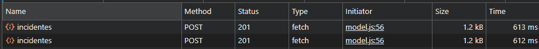
    <br><em>Figura T1. Defecto 1 (antes): con la red limitada a 4G lenta, un doble clic envía dos POST (201) desde model.js y duplica el incidente.</em>
</p>

<p align="center">
    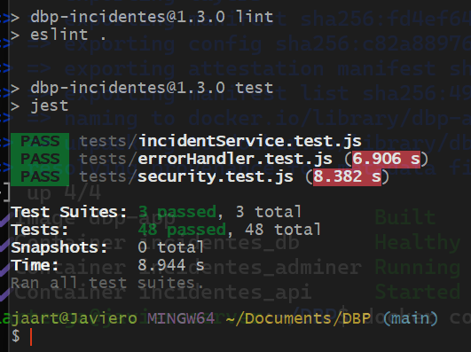
    <br><em>Figura T2. ESLint sin problemas y 48 pruebas unitarias aprobadas en 3 suites.</em>
</p>

<p align="center">
    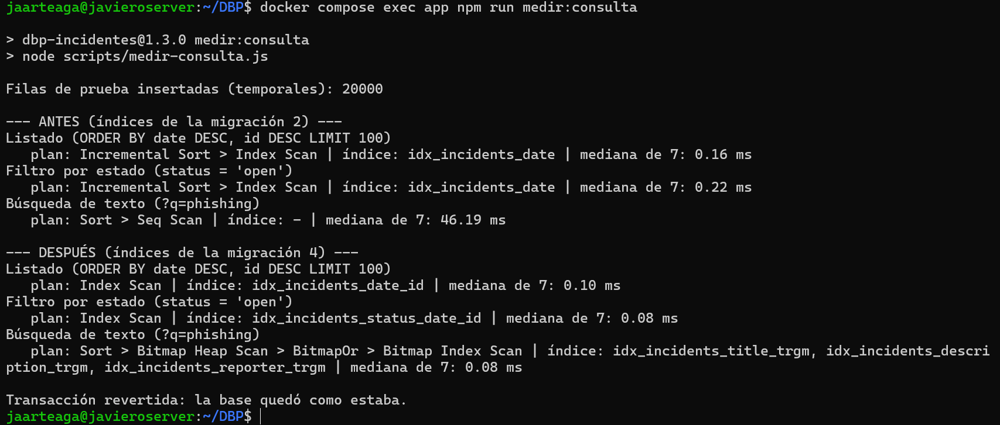
    <br><em>Figura T3. Medición en el servidor: la búsqueda de texto baja de 46,19 ms (Seq Scan) a 0,08 ms (Bitmap Index Scan).</em>
</p>

<p align="center">
    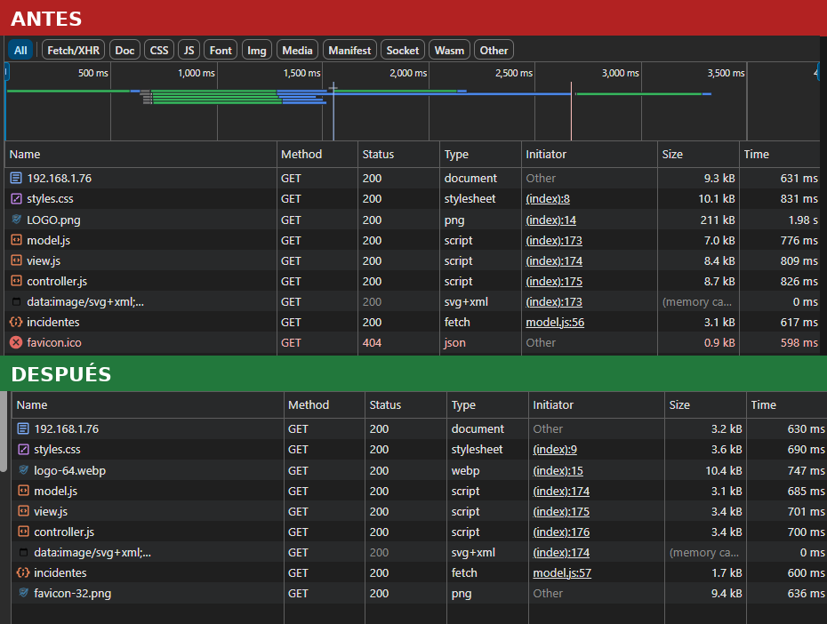
    <br><em>Figura T4. Pestaña Red antes y después: logo de 211 kB a 10,4 kB, CSS y JS comprimidos y favicon corregido (404 → 200).</em>
</p>

## Actualización del servidor para la Unidad 7

```bash
cd ~/DBP && git pull
docker compose --profile full up -d --build      # aplica la migración 4 al arrancar
docker compose exec app npm run medir:consulta   # medición de la consulta
```

## ENTREGA T1S7

En esta séptima entrega se pasó de "parece funcionar" a "se puede demostrar que funciona mejor". Se depuraron y corrigieron dos defectos con DevTools, se añadieron 48 pruebas unitarias con Jest para las reglas de negocio y de seguridad, se configuró ESLint (de 10 problemas a 0), se midieron y mejoraron una consulta, una imagen y las solicitudes de red, y se refactorizó el módulo de incidentes en controlador, servicio y modelo sin cambiar su comportamiento.

___

## Instrucciones T1S8

Integre y despliegue la plataforma de incidentes. Debe incluir CRUD persistente, autenticación, autorización, validación, HTTPS, configuración por entorno, logs, health check, pruebas finales y evidencias. Entregue URL, repositorio versionado, documentación técnica, manual de usuario y presentación. Realice una defensa con demostración del flujo y responda preguntas sobre arquitectura, seguridad, pruebas y limitaciones.

### Entregables

| Entregable | Dónde |
|---|---|
| **URL de producción** | **https://dbp-incidentes.onrender.com** |
| Repositorio versionado | Este repositorio, etiqueta `v2.0.0` |
| Documentación técnica | [`docs/DOCUMENTACION_TECNICA.md`](docs/DOCUMENTACION_TECNICA.md) |
| Manual de usuario | [`docs/MANUAL_USUARIO.md`](docs/MANUAL_USUARIO.md) |
| Pruebas en producción | [`reportes/pruebas-produccion.txt`](reportes/pruebas-produccion.txt) |

> **Aviso:** la plataforma usa el plan gratuito de Render. Tras 15 minutos sin visitas el servicio se suspende y **la primera carga tarda cerca de un minuto**, mostrando la pantalla de abajo. No es un error: basta con esperar sin recargar; después responde con normalidad.

<p align="center">
    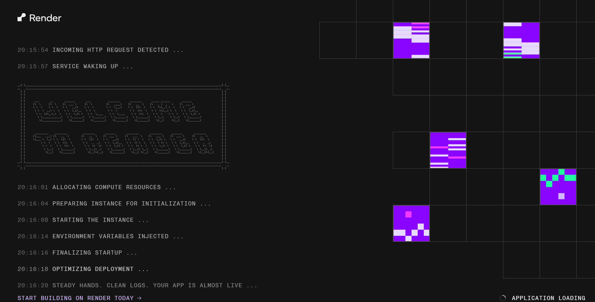
    <br><em>Figura P0. Pantalla que muestra Render mientras el servicio despierta (en esta captura, unos 30 segundos).</em>
</p>

## Decisión de despliegue

El servidor Ubuntu que se usó desde la quinta entrega también aloja otros servicios con información personal. Publicarlo en internet, ya sea abriendo puertos del router o con un túnel, habría hecho que el tráfico de cualquier persona llegara a esa misma máquina. Por eso **producción se desplegó en Render**, una infraestructura separada, y el servidor propio quedó como entorno de pruebas, sin cambios en su exposición.

| Entorno | Dónde | Para qué |
|---|---|---|
| Desarrollo | PC | Editar código, `npm test`, `npm run lint` |
| Pruebas | Servidor Ubuntu (Docker Compose, red local) | Probar cambios antes de publicarlos |
| **Producción** | **Render** (región Virginia) | URL pública evaluada |

Cada entorno usa credenciales distintas. La infraestructura de producción está descrita como código en `render.yaml` (Blueprint): la base PostgreSQL 16 **sin acceso desde internet** (`ipAllowList: []`, solo red privada), el servicio web que reutiliza el mismo `Dockerfile`, el health check, y las variables. `JWT_SECRET` lo genera Render, y las contraseñas iniciales se ingresan en el panel, nunca en el repositorio.

```
Navegador ──HTTPS──> Render (certificado TLS) ──> API Express (Docker) ──red privada──> PostgreSQL 16
```

<p align="center">
    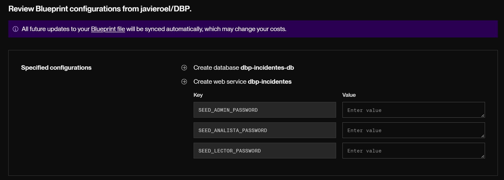
    <br><em>Figura P1. Blueprint de Render: la infraestructura sale de render.yaml y los secretos se ingresan en el panel, no en el código.</em>
</p>

<p align="center">
    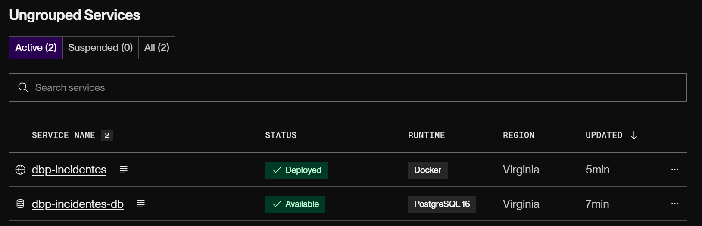
    <br><em>Figura P2. Servicio web (Docker) desplegado y base PostgreSQL 16 disponible, en la misma región para usar la red privada.</em>
</p>

### Gestión de secretos

Durante la preparación de esta entrega se detectó que una copia del `.env` de desarrollo, con la contraseña real de la base local, había sido compartida como material de contexto en una herramienta externa. El repositorio no estaba afectado (`git log --all -- .env` sin resultados). El archivo se retiró y **la contraseña de la base se rotó** en el servidor de pruebas con `\password` (la clave nueva no queda en el historial de comandos), verificando después que `/api/salud` respondía `200`. Producción nació con secretos nuevos: `JWT_SECRET` generado por Render y contraseñas de usuarios ingresadas en el panel. El detalle está en la [documentación técnica, sección 13](docs/DOCUMENTACION_TECNICA.md#13-gestión-de-secretos-e-incidente-registrado).

## Mejoras realizadas

| Requisito | Antes (T1S7) | Después (T1S8) | Dónde |
|---|---|---|---|
| URL pública con HTTPS | Solo red local, CA interna de Caddy | Render con certificado válido y HSTS | `render.yaml` |
| Configuración por entorno | Solo variables `DB_*` | También `DATABASE_URL`; la app no arranca si falta un valor o si es inválido | `src/config/config.js` |
| Logs | Texto plano por consola | Una línea JSON por evento con nivel, fecha, id de solicitud, usuario y duración; campos sensibles ocultos y correos enmascarados | `src/utils/log.js`, `src/middleware/logger.js` |
| Eventos de seguridad | Mensajes sueltos | Marcados para filtrarlos: `seguridad.login_fallido`, `seguridad.acceso_denegado`, `seguridad.cors_bloqueado` | Ídem |
| Trazabilidad de errores | Sin relación entre el error del usuario y el log | Cabecera `X-Request-Id` y campo `solicitud` en cada error | `src/middleware/errorHandler.js` |
| Health check | Revelaba la tecnología (`motor: Express`) | Versión, commit, entorno y estado de la base; `503` si la base no responde | `app.js` |
| Publicación | Manual con `docker compose` | Imagen única para pruebas y producción; migraciones y datos iniciales al arrancar; apagado ordenado ante `SIGTERM` | `Dockerfile`, `app.js` |
| Datos iniciales | Fallaban si se ejecutaban dos veces | Seeders idempotentes | `seeders/` |
| Contraseñas en el código | `pruebas.js` tenía contraseñas por defecto | Se leen solo de variables de entorno | `scripts/pruebas.js` |
| IP del cliente detrás de proxies | `trust proxy` fijo en 1 (pensado para Caddy) | `TRUST_PROXY` configurable y validado; el log registra cuántos saltos trae `X-Forwarded-For` | `src/config/security.js`, `app.js` |
| Pruebas unitarias | 48 (83,8 %) | **60 (89,3 %)**, nueva suite `tests/operacion.test.js` | `tests/` |
| Limpieza | Archivos `tmp-*.json` en la raíz | Eliminados | — |

Ejemplo de un evento de seguridad en los logs (el correo se enmascara y no hay contraseñas ni tokens):

```json
{"time":"2026-10-24T23:57:15.036Z","level":"warn","msg":"login_fallido","event":"seguridad.login_fallido","reqId":"cb6dfc9e-7099-4261-acc5-80d5b5842bb1","email":"ad***@incidentes.local","ip":"…"}
```

<p align="center">
    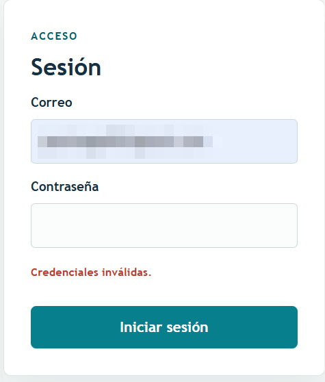
    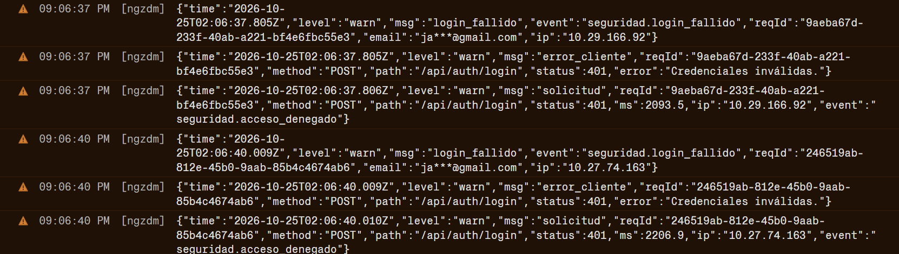
    <br><em>Figura P7. Un inicio de sesión fallido en producción (izquierda) y su rastro en los logs de Render (derecha): el correo aparece enmascarado y los tres eventos comparten el mismo <code>reqId</code>.</em>
</p>

### Hallazgo en producción: la IP del cliente

Al revisar la Figura P7 se detectó que dos intentos hechos **desde el mismo equipo** quedaron registrados con IPs distintas (`10.29.166.92` y `10.27.74.163`). Son direcciones **internas** de los proxies de Render y Cloudflare, no la del cliente. La causa era `trust proxy` fijo en 1, valor pensado para Caddy (un solo salto). Las consecuencias eran dos:

- los logs no identificaban al cliente real;
- el límite de 10 intentos de login "por IP" se aplicaba por proxy interno y no por atacante, lo que **debilitaba la protección contra fuerza bruta**.

La corrección **no adivina** el número de proxies, porque Render no lo documenta oficialmente. `TRUST_PROXY` es ahora configurable y validado: la app no arranca con `true`, que permitiría falsificar la IP enviando un encabezado propio. Además, cada log registra `xff`, que es la **cantidad** de saltos en `X-Forwarded-For` (nunca las IPs), para medir el valor correcto en producción.

El health check en producción identifica la versión exacta que está corriendo (versión y commit), el entorno y el estado de la base, sin revelar tecnologías internas:

<p align="center">
    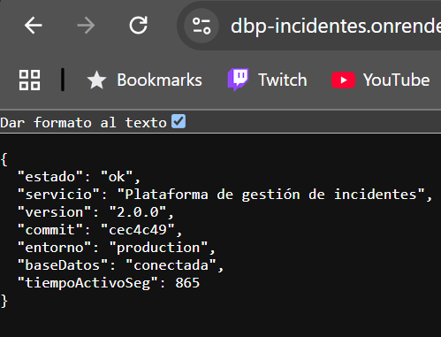
    <br><em>Figura P5. Health check de producción: versión 2.0.0, commit cec4c49, entorno production y base conectada.</em>
</p>

Las cabeceras de seguridad de la sexta entrega siguen activas en producción, ahora con **HSTS** (posible porque hay HTTPS real), `upgrade-insecure-requests` en la CSP y el `X-Request-Id` de cada respuesta. `X-Powered-By` no aparece.

<p align="center">
    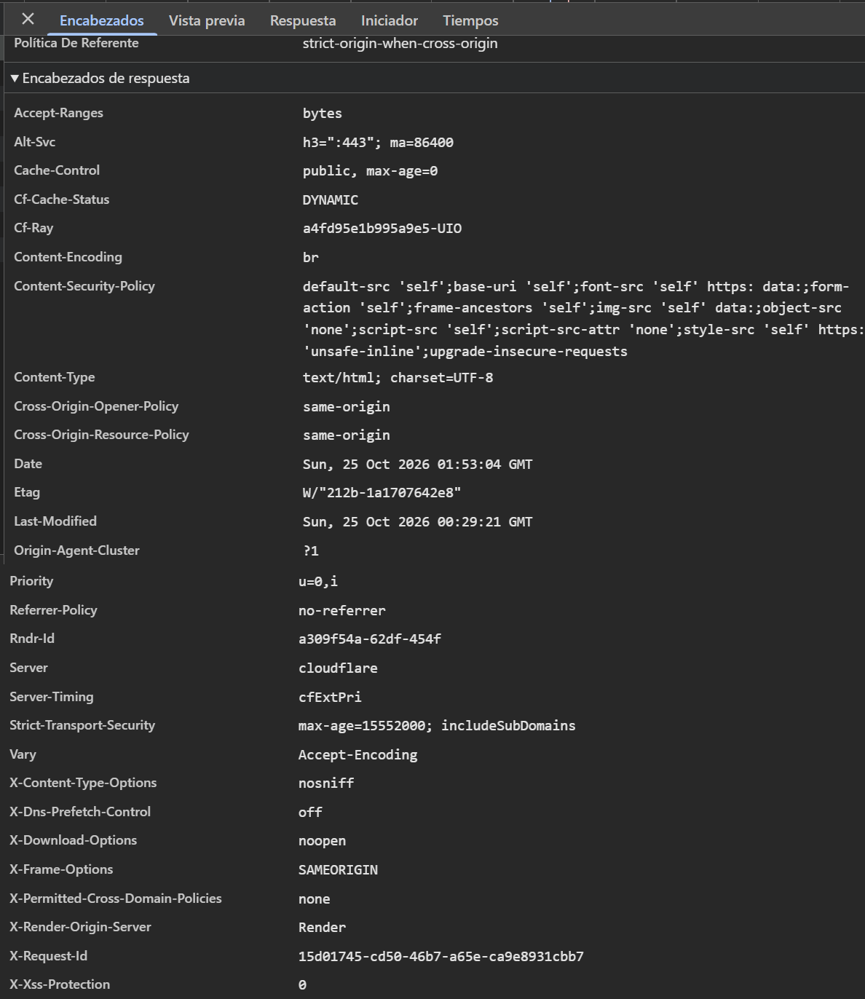
    <br><em>Figura P6. Encabezados de respuesta en producción (DevTools → Red).</em>
</p>

## Pruebas finales en producción

El script de la sexta entrega se ejecutó contra la URL pública: **39 de 39 casos** con el código HTTP esperado. Las contraseñas se ingresaron con `read -s`, así que no quedaron en el historial de la terminal.

```bash
export API_URL=https://dbp-incidentes.onrender.com
read -rsp "Clave admin: " ADMIN_PASSWORD; echo; export ADMIN_PASSWORD   # igual para analista y lector
npm run probar
```

| Grupo | Casos | Resultado |
|---|:-:|:-:|
| Autenticación (login por rol, clave incorrecta, correo inexistente) | 8 | ✅ |
| Acceso sin token o con token falso (`alg: none`, otra clave, rol modificado) | 6 | ✅ |
| CRUD con los permisos correctos | 5 | ✅ |
| Permisos insuficientes (`403`) | 4 | ✅ |
| Datos inválidos, regla de negocio (`409`), XSS, inyección SQL, asignación masiva | 10 | ✅ |
| CORS | 2 | ✅ |
| Eliminación y comprobación de `404` | 4 | ✅ |

Pruebas unitarias y análisis estático después de los cambios de esta entrega:

<p align="center">
    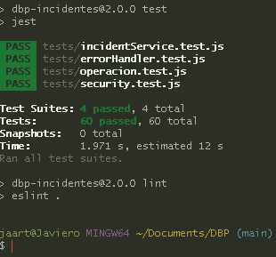
    <br><em>Figura P8. Jest con 60 pruebas aprobadas en 4 suites y ESLint sin problemas.</em>
</p>

<p align="center">
    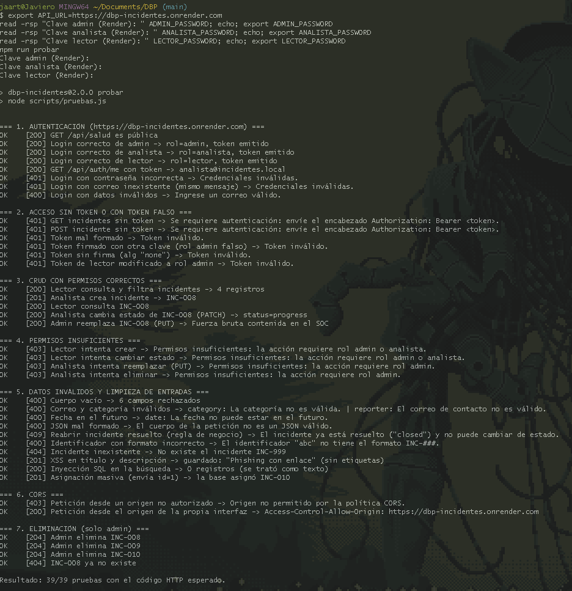
    <br><em>Figura P3. Pruebas de integración contra producción: 39/39 con el código HTTP esperado.</em>
</p>

### Autorización por rol en producción

La misma pantalla cambia según el rol, y la API rechaza por su cuenta lo que el rol no permite (casos `403` de la tabla anterior). Con la sesión de **lector**, el formulario se bloquea con un aviso y el detalle del ticket no muestra botones de estado ni de eliminación. Con la sesión de **administrador** (Figura M1 del [manual](docs/MANUAL_USUARIO.md)), el mismo INC-004 muestra **Pasar a revisión**, **Marcar resuelto** y **Eliminar**.

<p align="center">
    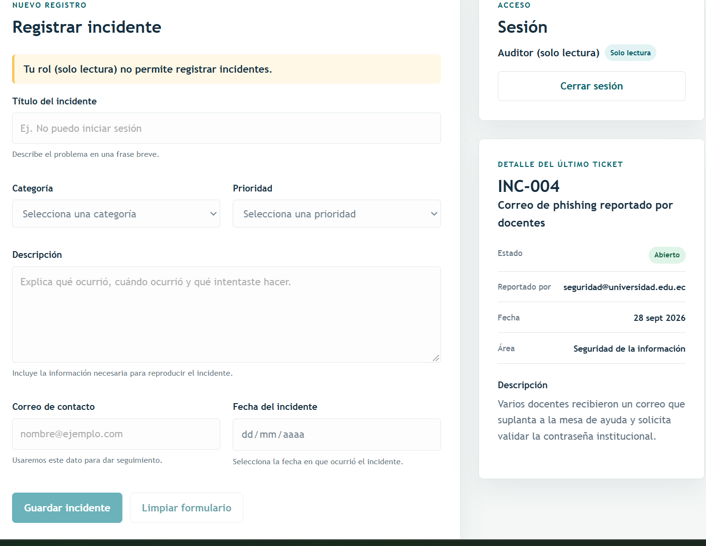
    <br><em>Figura P4. Sesión de lector en producción: formulario bloqueado y detalle sin acciones.</em>
</p>

## Documentación

- **[Documentación técnica](docs/DOCUMENTACION_TECNICA.md):** arquitectura, entornos, variables, instalación, modelo de datos, API, seguridad, logs y monitoreo, pruebas, despliegue y reversión, limitaciones.
- **[Manual de usuario](docs/MANUAL_USUARIO.md):** acceso, roles, registro, búsqueda, seguimiento, eliminación y solución de problemas.

## Cómo actualizar producción

```bash
npm test && npm run lint                 # verificaciones antes de publicar
git push origin main && git push --tags
# Render: Manual Deploy → Deploy latest commit (los despliegues automáticos están desactivados)
curl https://dbp-incidentes.onrender.com/api/salud   # confirmar versión y commit
```

Si la versión nueva falla: Render → **Events** → **Rollback** al despliegue anterior.

## ENTREGA T1S8

En esta octava entrega la plataforma pasó de funcionar en una red local a ser un servicio público, operable y verificable. Se desplegó en Render con HTTPS válido y una base sin acceso desde internet, manteniendo el servidor propio aislado como entorno de pruebas. La configuración se lee por entorno y la aplicación se niega a arrancar si falta un valor. Los logs ahora son estructurados, marcan los eventos de seguridad y nunca registran secretos. El health check informa versión y estado de la base. Las pruebas finales se ejecutaron contra producción con 39/39 casos, más 60 pruebas unitarias y ESLint sin problemas. Se entregan además la documentación técnica y el manual de usuario.

___
