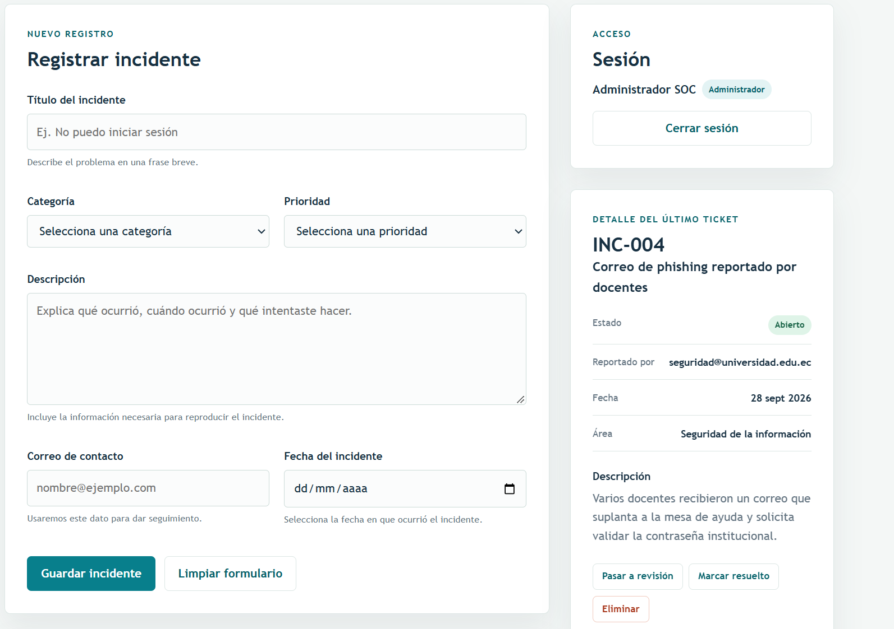
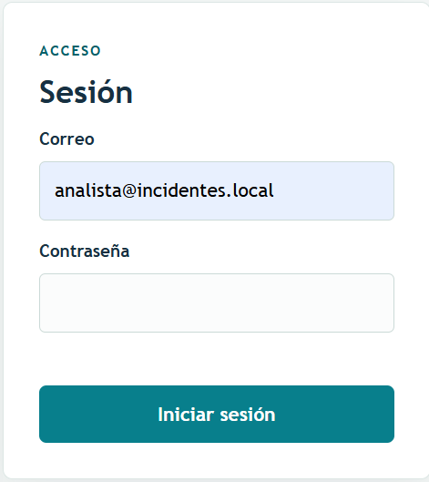
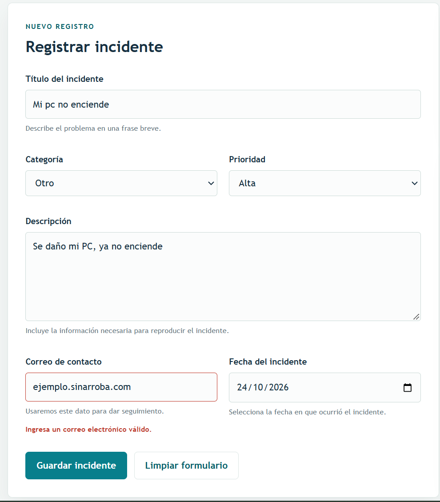
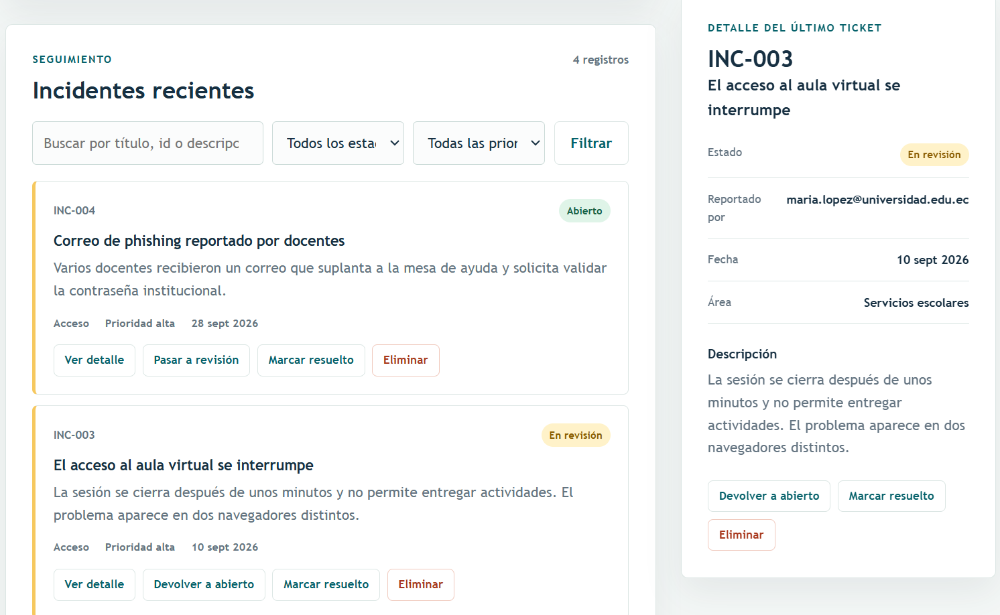
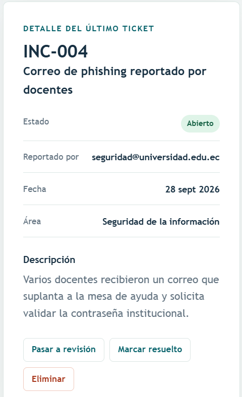

# **MANUAL DE USUARIO – PLATAFORMA DE GESTIÓN DE INCIDENTES**

| | |
|---|---|
| **Versión** | 2.0.0 |
| **Fecha** | 24/10/2026 |
| **Dirección** | https://dbp-incidentes.onrender.com |
| **Navegadores** | Chrome, Edge, Firefox o Safari actualizados, en computador o celular |

> **Primera carga:** si la plataforma no se usó en los últimos 15 minutos, puede tardar **cerca de un minuto** en abrir y mostrará la pantalla de abajo. Es normal: el servicio se está encendiendo. Espere y no recargue repetidamente.

    
     <em>Figura M0. Pantalla de espera mientras la plataforma se enciende.</em>

___

## 1. ¿Para qué sirve?

La plataforma permite **registrar, consultar, dar seguimiento y cerrar incidentes de ciberseguridad** en un solo lugar: accesos indebidos, fallas de sistemas, problemas de red u otros eventos. Cada incidente recibe un código (`INC-###`), una prioridad y un estado que muestra en qué etapa de atención está.

___

## 2. Roles y permisos

Lo que puede hacer depende del rol de su cuenta. La pantalla solo muestra los botones que su rol permite.

| Acción | Administrador | Analista | Lector (auditor) |
|---|:-:|:-:|:-:|
| Consultar y buscar incidentes | ✅ | ✅ | ✅ |
| Registrar un incidente | ✅ | ✅ | ❌ |
| Cambiar el estado | ✅ | ✅ | ❌ |
| Eliminar un incidente | ✅ | ❌ | ❌ |

Cuentas de demostración: `admin@incidentes.local`, `analista@incidentes.local` y `lector@incidentes.local`. Las contraseñas se entregan por un canal separado y no se publican en este documento.

___

## 3. Partes de la pantalla

    
     <em>Figura M1. Pantalla principal con sesión de administrador: formulario de registro, sesión y detalle del ticket.</em>

| Zona | Contenido |
|---|---|
| **Encabezado** | Logo y nombre de la plataforma |
| **Registrar incidente** | Formulario para crear un incidente nuevo |
| **Incidentes recientes** | Barra de búsqueda y filtros, y la lista de incidentes con sus botones de acción |
| **Panel lateral** | Sesión (iniciar o cerrar) y el detalle del incidente seleccionado |

___

## 4. Iniciar y cerrar sesión

1. En el panel lateral, sección **Sesión**, escriba su **Correo** y **Contraseña**.
2. Pulse **Iniciar sesión**.
3. Verá su nombre y su rol. La lista de incidentes se carga automáticamente.

    
     <em>Figura M2. Inicio de sesión.</em>

Para salir, pulse **Cerrar sesión**. Por seguridad:
- La sesión dura **1 hora**; al vencer, la plataforma la cierra y pide ingresar de nuevo.
- La sesión se borra al cerrar la pestaña del navegador.
- Después de **10 intentos fallidos** en 15 minutos, el inicio de sesión se bloquea temporalmente.

___

## 5. Registrar un incidente

*Disponible para administrador y analista. Con el rol lector, el formulario aparece bloqueado con el aviso "Tu rol (solo lectura) no permite registrar incidentes" y el detalle no muestra botones de acción.*

    
     <em>Figura M6. Vista del rol lector: solo consulta.</em>

1. Complete los campos de **Registrar incidente**:

| Campo | Qué escribir | Regla |
|---|---|---|
| Título del incidente | Resumen breve del problema | 5 a 80 caracteres |
| Categoría | Acceso, Sistema, Red u Otro | Obligatorio |
| Prioridad | Alta, Media o Baja | Obligatorio |
| Descripción | Qué ocurrió, cuándo y qué se intentó | 20 a 500 caracteres |
| Correo de contacto | Correo de quien reporta | Formato de correo válido |
| Fecha del incidente | Día en que ocurrió | No puede ser una fecha futura |

2. Pulse **Guardar incidente**. El botón muestra "Guardando…" mientras se envía; no lo pulse de nuevo.
3. El incidente aparece al inicio de la lista con su código `INC-###` y estado **Abierto**.

Si un campo es incorrecto, aparece un mensaje en rojo debajo de él. Corríjalo y vuelva a guardar. **Limpiar formulario** borra todos los campos.

    
     <em>Figura M3. Registro de un incidente: el correo sin @ se marca en rojo y el formulario no se envía hasta corregirlo.</em>

___

## 6. Buscar y filtrar

En **Incidentes recientes**:

1. **Buscar incidente:** escriba parte del título, el código o la descripción.
2. **Filtrar por estado:** Abierto, En revisión o Resuelto.
3. **Filtrar por prioridad:** Alta, Media o Baja.
4. Pulse **Filtrar**. El contador indica cuántos registros coinciden.

Para ver todos de nuevo, deje la búsqueda vacía, elija "Todos los estados" y "Todas las prioridades", y pulse **Filtrar**.

___

## 7. Ver el detalle

Pulse **Ver detalle** en cualquier incidente. El **panel lateral derecho**, bajo "Detalle del último ticket", muestra toda su información (estado, quién lo reportó, fecha, área y descripción) y los mismos botones de acción que la tarjeta. El panel acompaña el desplazamiento mientras recorre la lista, así que el detalle siempre queda a la vista.

    
     <em>Figura M5. Lista de incidentes con filtros y, en el panel lateral, el detalle del incidente seleccionado.</em>

___

## 8. Dar seguimiento (cambiar el estado)

*Disponible para administrador y analista.*

Los botones de estado aparecen en cada incidente según su estado actual:

| Estado actual | Botones disponibles |
|---|---|
| **Abierto** | Pasar a revisión · Marcar resuelto |
| **En revisión** | Devolver a abierto · Marcar resuelto |
| **Resuelto** | Ninguno |

Un incidente **Resuelto no se puede reabrir**. Si el problema vuelve a ocurrir, registre un incidente nuevo. Así queda constancia de cada ocurrencia.

    
     <em>Figura M4. Cambio de estado de un incidente.</em>

___

## 9. Eliminar un incidente

*Disponible solo para administrador.*

1. Pulse **Eliminar** en el incidente.
2. El botón cambia a **Confirmar eliminación**. Púlselo para borrar definitivamente. Si no confirma en unos segundos, el botón vuelve a su estado normal.

La eliminación no se puede deshacer. Para un incidente atendido se recomienda **Marcar resuelto** en lugar de eliminarlo, y reservar la eliminación para registros duplicados o de prueba.

___

## 10. Mensajes frecuentes y solución de problemas

| Mensaje o situación | Qué significa | Qué hacer |
|---|---|---|
| La página tarda en abrir | El servicio se estaba encendiendo | Esperar alrededor de un minuto |
| "Credenciales inválidas." | Correo o contraseña incorrectos | Revisar mayúsculas y espacios; volver a intentar |
| "Demasiados intentos de inicio de sesión. Espere 15 minutos." | Se superaron 10 intentos fallidos | Esperar 15 minutos |
| "El token expiró. Inicie sesión de nuevo." | Pasó la hora de la sesión | Iniciar sesión otra vez |
| "Tu rol no permite registrar incidentes." | La cuenta es de lector | Pedir a un administrador la acción o una cuenta con permisos |
| "Permisos insuficientes…" | La acción no corresponde a su rol | Igual que el anterior |
| "La fecha no puede estar en el futuro." | Se eligió un día posterior a hoy | Elegir la fecha real del incidente |
| "El incidente ya está resuelto…" | Se intentó cambiar un incidente resuelto | Registrar un incidente nuevo |
| "No hay incidentes para los filtros seleccionados." | Ningún registro coincide | Cambiar o limpiar los filtros |
| "Base de datos no disponible. Intente más tarde." | Falla temporal del servidor | Esperar unos minutos e informar al administrador |

**Al reportar un problema** al administrador, indique la hora y, si el mensaje lo muestra, el **código de solicitud**. Con ese código se encuentra el evento exacto en los registros del servidor.

___

## 11. Accesibilidad

- Toda la plataforma se puede usar **solo con teclado**: `Tab` para avanzar, `Shift + Tab` para retroceder y `Enter` para activar.
- Los mensajes importantes (incidente registrado, errores, cambios de estado) se anuncian a los **lectores de pantalla**.
- Cada campo tiene su etiqueta y sus mensajes de error junto a él.
- La interfaz se adapta a celulares y tabletas.

___

## 12. Buenas prácticas de seguridad para el usuario

- No comparta su contraseña ni la escriba en documentos o chats.
- Cierre sesión al terminar, en especial en equipos compartidos.
- No registre contraseñas, datos personales innecesarios ni información confidencial en la descripción de un incidente.
- Verifique que la dirección empiece con `https://dbp-incidentes.onrender.com` antes de ingresar su contraseña.
